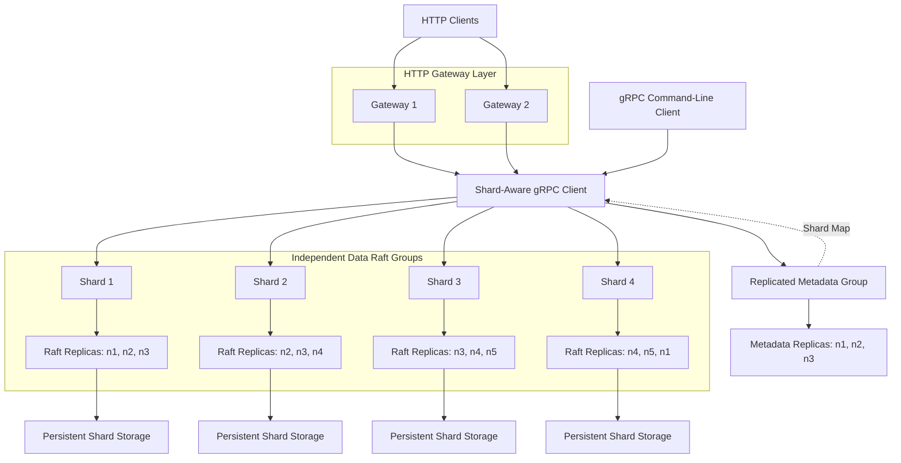
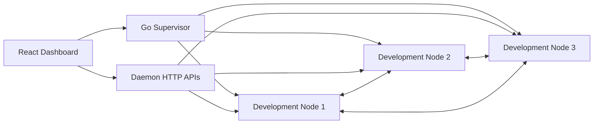
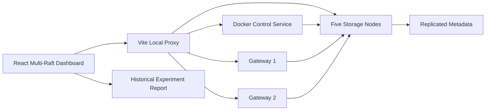
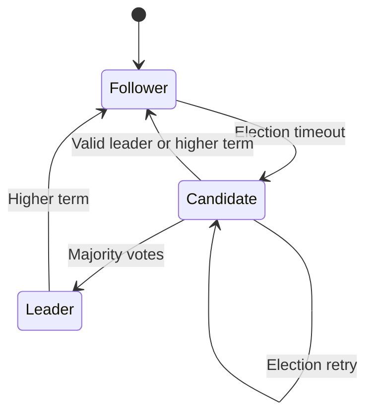
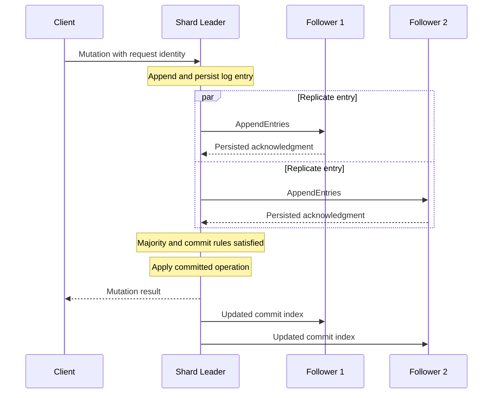
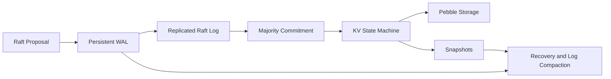
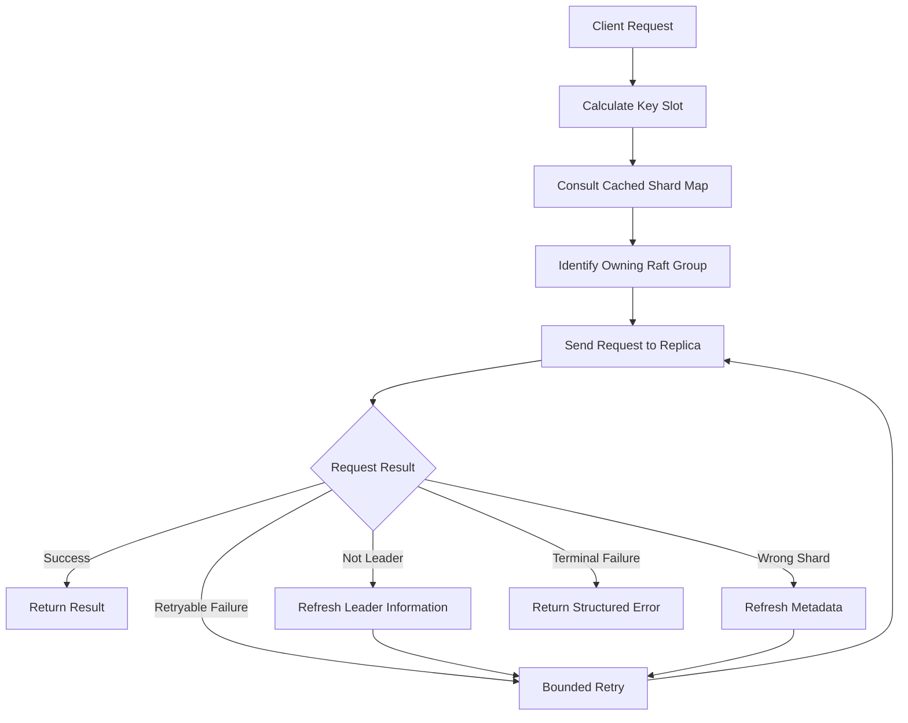
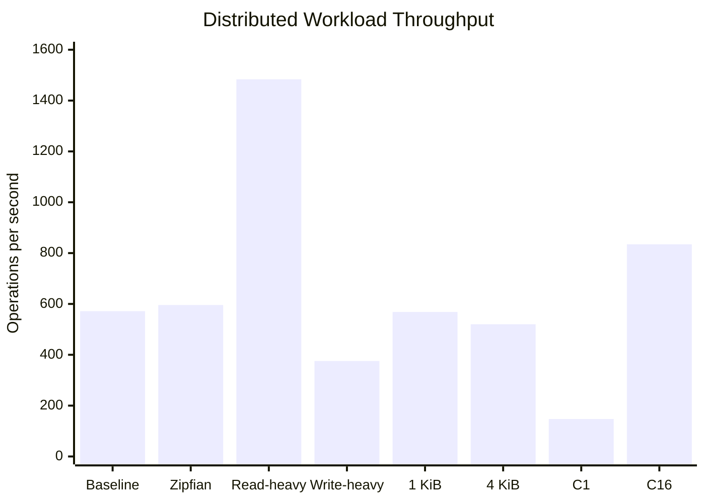
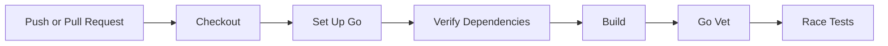

# ShardRAFT

### A Fault-Tolerant Distributed Key-Value Database Built with Raft

[](go.mod)
[](https://github.com/KrishShah1912/ShardRAFT/actions/workflows/ci.yml)
[](web/package.json)
[](docker-compose.yml)
[](proto/)
[](LICENSE)

**Custom Raft Consensus | Durable Storage | Multi-Raft Sharding |
Linearizable Reads | Automatic Failover | Distributed Evaluation**

ShardRAFT is a distributed key-value database implemented in Go,
designed to demonstrate how distributed storage systems achieve
consistency, fault tolerance, durability, and horizontal data
partitioning through consensus-based replication.

The project implements its own Raft consensus engine rather than
delegating consensus to an external Raft library. It combines persistent
storage, replicated metadata, shard-aware routing, gRPC services,
HTTP gateways, a command-line client, and an interactive React dashboard.

**Project status:** All eleven planned backend milestones and the Multi-Raft frontend implementation are complete.
Backend validation and focused frontend end-to-end testing passed.

**Academic project:** CSE 512 — Distributed Database Systems,
Arizona State University.

---

## Table of Contents

- [Quick Start — Fresh Machine](#quick-start--fresh-machine)
- [Project Highlights](#project-highlights)
- [Key Features](#key-features)
- [System Architecture](#system-architecture)
- [Technology Stack](#technology-stack)
- [Repository Structure](#repository-structure)
- [Raft Consensus](#raft-consensus)
- [Persistent Storage and Recovery](#persistent-storage-and-recovery)
- [Multi-Raft Sharding](#multi-raft-sharding)
- [Metadata and Request Routing](#metadata-and-request-routing)
- [Consistency and Request Deduplication](#consistency-and-request-deduplication)
- [Getting Started](#getting-started)
- [Docker Deployment](#docker-deployment)
- [HTTP API](#http-api)
- [gRPC Services and CLI](#grpc-services-and-cli)
- [Web Dashboard](#web-dashboard)
- [Fault Tolerance](#fault-tolerance)
- [Correctness Verification](#correctness-verification)
- [Performance Evaluation](#performance-evaluation)
- [Testing and Continuous Integration](#testing-and-continuous-integration)
- [Implementation Milestones](#implementation-milestones)
- [Documentation](#documentation)
- [Limitations](#limitations)
- [Team](#team)
- [References](#references)
- [License](#license)

---

## Quick Start — Fresh Machine

The complete ShardRAFT Multi-Raft demo runs locally with Docker Compose.
This is the recommended setup for instructors, evaluators, and anyone
who wants to explore the working system without installing the Go or
frontend development toolchains.

### Prerequisite

Install and start **Docker Desktop** on macOS or Windows, or Docker
Engine with the Docker Compose plugin on Linux.

Verify Docker:

    docker info
    docker compose version

**No local Go, Node.js, npm, database, or frontend installation is
required for the evaluator demo.** Application components are built
inside Docker.

### Clone and Start

    git clone https://github.com/KrishShah1912/ShardRAFT.git
    cd ShardRAFT
    make demo

The demo starts:

- five Multi-Raft storage nodes
- four independent data Raft groups
- one replicated metadata Raft group
- two HTTP gateways
- the production React dashboard served by nginx

Wait for:

    Storage nodes ..... 5/5 healthy
    Gateways .......... running
    Dashboard ......... healthy

    =================================
    ShardRAFT is ready
    =================================

Then open:

**http://127.0.0.1:18080**

### Stop the Demo

    make demo-down

Persistent Docker volumes are preserved during normal shutdown.

To inspect running services:

    docker compose ps

### Evaluator and Development Modes

`make demo` is the recommended evaluator workflow. The database,
gateways, and production dashboard run through Docker.

Host-level Docker lifecycle controls used by the interactive Fault Lab
are intentionally not exposed through the production dashboard. Full
fault injection is available through the trusted local development
workflow documented later in this README.

### Troubleshooting

If Docker is installed but not running, start Docker Desktop and retry:

    make demo

If another ShardRAFT demo is already running:

    make demo-down
    make demo

For container status and logs:

    docker compose ps
    docker compose logs

---
## Project Highlights

| Metric | Result |
|---|---:|
| Storage nodes | 5 |
| HTTP gateways | 2 |
| Independent data Raft groups | 4 |
| Replicated metadata groups | 1 |
| Logical hash slots | 65,536 |
| Replication factor per group | 3 |
| Successful distributed benchmark operations | 8,000 |
| Linearizable recorded benchmark histories | 8/8 |
| Peak measured workload throughput | 1,483.75 ops/sec |
| Measured end-to-end leader failover | 1.337 seconds |
| Measured replica recovery | 0.949 seconds |
| WAL microbenchmark records | 30,000 |
| Final local race-tested packages passed | 22/22 |
| Multi-Raft dashboard pages | 15 |
| Multi-Raft browser tests passed | 7/7 |
| Browser-observed leader failover | 3.165 seconds |
| Browser-observed replica recovery | 1.463 seconds |

Performance figures represent measured local experiments,
not guaranteed production performance.

---

## Key Features

### Distributed Consensus

- Custom implementation of the Raft consensus algorithm.
- Follower, candidate, and leader state transitions.
- Randomized election timeouts and automatic leader election.
- Term-based voting and heartbeat communication.
- Majority-based log replication and commitment.
- Current-term commit rules and leader no-op entries.
- Follower catch-up and conflicting-log reconciliation.
- AppendEntries request-response correlation.
- Protection against stale and reordered replication responses.
- Deterministic simulation and consensus invariant testing.

### Durable Storage

- Persistent Raft hard state and replicated logs.
- Segmented write-ahead logging.
- Checksummed WAL records.
- Pebble-backed key-value storage.
- Snapshot creation and restoration.
- Log compaction and restart recovery.
- Persistent mutation deduplication.
- Independent persistent storage for each deployed node.

### Distributed Database Operations

- GET, PUT, DELETE, and compare-and-swap.
- Quorum-confirmed linearizable reads through ReadIndex.
- Explicit local reads for applications that tolerate stale data.
- Automatic metadata discovery and leader-aware routing.
- Bounded request retries and operation deadlines.
- Stable mutation identities across retries.
- Structured error responses and uncertain mutation handling.

### Physical Sharding

- 65,536 deterministic logical hash slots.
- Four independent data-shard Raft groups.
- Three replicas per data shard.
- Five physical storage nodes.
- A separate replicated metadata Raft group.
- Versioned shard maps and ownership validation.
- Shard-aware gRPC clients and HTTP gateways.
- Independent replication and leadership within each group.

### Deployment and Observability

- Five-node, two-gateway Docker Compose deployment.
- Independent named data volumes.
- Storage-node health and status endpoints.
- Non-root container runtime.
- React and TypeScript dashboard with two deployment modes.
- Live five-node Multi-Raft cluster monitoring.
- Shard-aware database operations through both HTTP gateways.
- Browser-based Docker node lifecycle controls.
- Session-scoped unresolved mutation persistence.
- Historical correctness and performance visualization.
- Database explorer and query console.
- Cluster status and replication visualization.
- Controlled node failure and recovery experiments.

### Correctness and Evaluation

- Concurrent operation-history recording.
- Porcupine single-key linearizability checking.
- Uniform and Zipfian workload generation.
- Configurable record sizes and read/write ratios.
- Throughput and latency percentile measurements.
- Leader failover and replica recovery measurements.
- Isolated WAL synchronization cost comparison.
- Automated experiment execution and raw CSV generation.
- GitHub Actions build, static analysis, and race-test workflow.

---

## System Architecture

ShardRAFT separates client-facing request handling from replicated
storage and metadata management.

The multi-Raft deployment runs four independent data groups and
one metadata group across five storage nodes.



Each data group maintains its own Raft state, leader,
replicated log, commit progress, and persistent state machine.

The metadata group maintains the versioned shard map used
for routing client requests.

### Development Dashboard Architecture

The dashboard supports both the original three-node development
cluster and the physical five-node Multi-Raft Docker deployment.

Development mode uses the existing Go supervisor and daemon APIs.
Multi-Raft mode uses the Docker storage diagnostics APIs,
standalone HTTP gateways, and a local Docker control service.



The single-shard development mode remains available alongside
the physical multi-Raft deployment.

### Multi-Raft Dashboard Architecture



The dashboard displays live observations from the running deployment.
Performance and correctness experiment summaries are explicitly
identified as historical evidence.

---

## Technology Stack

| Technology | Purpose |
|---|---|
| Go 1.27.3 | Consensus engine, storage, networking, and services |
| Custom Raft | Distributed consensus and replicated logs |
| Pebble 1.1.5 | Embedded key-value storage |
| gRPC 1.72.0 | Node communication and client-facing RPCs |
| Protocol Buffers 1.36.6 | RPC contracts and message serialization |
| CRC32 IEEE | Deterministic key-to-slot mapping |
| React 19 | Interactive database dashboard |
| TypeScript 5.7 | Typed frontend application |
| Vite 7 | Frontend development and production build |
| Lucide React | Dashboard icons |
| Docker | Containerized services |
| Docker Compose | Local multi-node deployment |
| Porcupine 1.0.3 | Single-key linearizability checking |
| Go testing framework | Backend unit and integration tests |
| Go race detector | Concurrent memory-access validation |
| Playwright | Browser end-to-end testing |
| Python 3 | Validation reporting and experiment aggregation |
| Bash and Make | Development and experiment automation |
| GitHub Actions | Automated repository validation |

---

## Repository Structure

The following structure summarizes the tracked repository
directories and primary entry points.

```text
ShardRAFT/
├── .github/
│   └── workflows/
│       └── ci.yml
├── cmd/
│   ├── bench/                  # Distributed workload generator
│   ├── chaosctl/               # Docker node failure controls
│   ├── checker/                # Porcupine correctness checker
│   ├── shardraft/              # gRPC command-line client
│   ├── shardraft-bench/        # Original benchmark CLI
│   ├── shardraft-docker-control/ # Local Docker lifecycle API
│   ├── shardraft-gateway/      # Standalone HTTP-gRPC gateway
│   ├── shardraft-supervisor/   # Development cluster supervisor
│   ├── shardraftd/             # Storage daemon and RPC services
│   └── walbench/               # WAL synchronization microbenchmark
├── internal/
│   ├── benchmark/              # Original benchmark infrastructure
│   ├── client/                 # Shard-aware gRPC client
│   ├── history/                # History recorder and checker model
│   ├── kvstore/                # Persistent KV state machine
│   ├── meta/                   # Slot mapping and metadata state
│   ├── observability/          # Cluster observation infrastructure
│   ├── raft/                   # Custom Raft consensus engine
│   ├── raftdriver/             # Raft execution and persistence
│   ├── shard/                  # Shard ownership and group dispatch
│   ├── simnet/                 # Deterministic cluster simulation
│   ├── snapshot/               # Snapshot persistence and recovery
│   ├── transport/              # Node-to-node communication
│   └── wal/                    # Persistent write-ahead logging
├── proto/
│   ├── admin.proto             # Administrative RPC contracts
│   ├── kv.proto                # Key-value RPC contracts
│   ├── meta.proto              # Metadata RPC contracts
│   ├── raft.proto              # Raft transport contracts
│   └── *.pb.go                 # Generated Go protobuf code
├── scripts/
│   ├── cluster-status.sh
│   ├── dev-cluster.sh
│   ├── dev.sh
│   ├── e2e-supervisor.sh
│   ├── generate-validation-report.py
│   ├── node-control.sh
│   ├── run_experiments.sh
│   └── stop-cluster.sh
├── test/
│   ├── integration_test.go
│   ├── fault_test.go
│   └── fault_measurement_test.go
├── web/
│   ├── src/                    # React application
│   ├── public/                 # Public and generated assets
│   ├── tests/                  # Frontend unit tests
│   ├── e2e/                    # Playwright browser tests
│   ├── package.json
│   └── vite.config.ts
├── docs/                       # Architecture and validation documents
├── Dockerfile
├── docker-compose.yml
├── Makefile
├── go.mod
├── go.sum
├── LICENSE
└── README.md
```

Generated binaries, local cluster data, and experiment results
are not part of the tracked source tree.

### Command-Line Applications

| Application | Responsibility |
|---|---|
| shardraftd | Runs a storage node in single-shard or multi-Raft mode |
| shardraft | Executes distributed KV operations through gRPC |
| shardraft-gateway | Exposes the shard-aware client through HTTP |
| shardraft-supervisor | Manages and observes the development cluster |
| shardraft-docker-control | Provides local Docker lifecycle controls |
| shardraft-bench | Original node-oriented benchmark utility |
| bench | Generates configurable distributed workloads |
| checker | Evaluates recorded single-key operation histories |
| chaosctl | Stops, starts, and restarts Docker storage nodes |
| walbench | Measures isolated file synchronization costs |

---

## Raft Consensus

ShardRAFT implements Raft directly in Go.

Each Raft group independently manages its election term,
vote state, replicated log, leader identity, commit index,
and follower replication progress.

### Leader Election



A candidate becomes leader after receiving a majority of votes.

For a three-replica group, two votes are required.

The leader sends heartbeats and coordinates log replication.
Higher-term messages cause outdated leaders or candidates
to step down.

### Log Replication



The leader tracks follower replication using nextIndex
and matchIndex.

The implementation includes:

- Previous-index and previous-term validation.
- Rejection of inconsistent log prefixes.
- Conflict reconciliation without overwriting committed entries.
- Follower catch-up through replication retries.
- Current-term majority commitment.
- Leader no-op entries.
- Monotonic commit-index progression.
- Correlated AppendEntries requests and responses.

### Deterministic Simulation

The internal/simnet package supports controlled testing of:

- Logical time and election timeouts.
- Network partitions.
- Selective message loss.
- Delayed and reordered messages.
- Duplicate replication responses.
- Leader replacement.
- Follower recovery.
- Randomized fault workloads.
- Consensus safety invariants.

Simulation complements real-network integration testing.

---

## Persistent Storage and Recovery

ShardRAFT persists Raft state and committed database operations
through its WAL, storage engine, and snapshot infrastructure.



The storage subsystem includes:

- Persistent Raft terms and voting state.
- Segmented write-ahead logs.
- Length-prefixed and checksummed WAL records.
- Durable replicated command storage.
- Pebble-backed key-value state.
- Persistent mutation identity tracking.
- Snapshot creation and restoration.
- Log compaction.
- Recovery from supported restart and crash scenarios.

The production segmented WAL explicitly synchronizes
records before completing its append path.

The isolated WAL benchmark does not modify production
durability behavior.

---

## Multi-Raft Sharding

ShardRAFT partitions the key space into 65,536 logical slots.

The slot for a key is calculated using:

```text
slot = CRC32_IEEE(key) mod 65536
```

Each key maps deterministically to one slot, and each slot
belongs to exactly one data shard.

### Shard Placement

| Group | Slot range | Replicas |
|---|---|---|
| S1 | 0–16,383 | n1, n2, n3 |
| S2 | 16,384–32,767 | n2, n3, n4 |
| S3 | 32,768–49,151 | n3, n4, n5 |
| S4 | 49,152–65,535 | n4, n5, n1 |
| Metadata | Not applicable | n1, n2, n3 |

### Physical Replica Distribution

| Node | S1 | S2 | S3 | S4 | Metadata |
|---|:---:|:---:|:---:|:---:|:---:|
| n1 | Yes | — | — | Yes | Yes |
| n2 | Yes | Yes | — | — | Yes |
| n3 | Yes | Yes | Yes | — | Yes |
| n4 | — | Yes | Yes | Yes | — |
| n5 | — | — | Yes | Yes | — |

Every data shard has three replicas and requires two
available, communicating replicas to maintain a quorum.

A single physical node failure leaves a majority in
each group, assuming the remaining nodes are healthy.

Two simultaneous physical node failures may remove
the quorum from one or more groups.

### Implemented Sharding Mechanisms

- Deterministic CRC32 slot calculation.
- Contiguous slot-range validation.
- Unique shard and replica validation.
- Ownership-enforcing shard wrappers.
- Typed wrong-shard errors.
- Local group dispatch.
- Independent physical Raft groups.
- Persistent metadata replication.
- End-to-end operations across all four data shards.

Multi-Raft mode is enabled through the storage daemon's
-multi-raft flag and is used by Docker Compose.

Live shard migration and dynamic rebalancing are outside
the implemented scope.

---

## Metadata and Request Routing

The metadata group maintains a versioned shard map.

The metadata state machine validates ownership ranges,
replica placement, and expected-version transitions.

Rejected metadata updates leave the state unchanged.

The shard-aware gRPC client provides:

- Automatic metadata discovery.
- Thread-safe shard-map caching.
- Reusable gRPC connections.
- Deterministic slot lookup.
- Leader-aware request routing.
- Metadata refresh following WRONG_SHARD errors.
- Bounded retries.
- Stable mutation identities.
- Structured error propagation.



Metadata discovery exposes locally committed metadata.
It is not itself a linearizable read operation.

---

## Consistency and Request Deduplication

### Linearizable Reads

The default gRPC and standalone HTTP gateway read mode
uses the ReadIndex mechanism.

ReadIndex provides:

- A current-term commitment requirement.
- Correlated heartbeat quorum confirmation.
- An applied-index safety barrier.
- Concurrent read support.
- Cancellation and bounded deadlines.
- Leadership-change protection.

A linearizable read does not require a new Raft log
entry for every GET request.

Explicit local reads are also supported, but may
return stale data.

The legacy daemon HTTP GET interface is distinct
from the standalone gateway's default linearizable GET.

### Mutation Identity

Each mutation is identified using:

```text
(client_id, request_id)
```

Retries preserve the original identity and operation contents.

The replicated state machine records mutation results
to support duplicate request handling.

This prevents a successfully committed historical mutation
from being applied again merely because a client retries it.

Conflicting reuse of a mutation identity is rejected.

An uncertain mutation outcome must not be interpreted
as proof that the operation failed to commit.

Deduplication is scoped to the relevant replicated
state machine rather than a global cross-shard transaction.

---

## Getting Started

For the simplest evaluator setup, use the Docker-only workflow:

    make demo

Then open `http://127.0.0.1:18080`.

The prerequisites and commands below are intended for contributors who want to build, test, or modify ShardRAFT directly.

### Prerequisites

- Go version specified in go.mod.
- Git.
- Docker Engine or Docker Desktop.
- Docker Compose.
- Node.js and npm for frontend development.
- Python 3 for validation and experiment scripts.

### Clone and Build

```bash
git clone https://github.com/KrishShah1912/ShardRAFT.git
cd ShardRAFT

go version
go mod download
go mod verify
go build ./...
```

### Development Commands

```bash
make build
make test
make race
make vet
```

The repository also provides development-cluster,
supervisor, frontend, and validation commands through
the Makefile.

---

## Docker Deployment

For the complete evaluator deployment, including the production web dashboard, use:

    make demo

The lower-level Docker Compose commands below are useful for development, debugging, and direct service inspection.

The recommended way to run the physical multi-Raft
database is through Docker Compose.

### Start the Cluster

```bash
docker compose up -d --build --wait
docker compose ps
```

The deployment starts:

- Five storage daemons.
- Two standalone HTTP-gRPC gateways.
- Five independent named data volumes.
- A shared Docker network.
- Storage-node health checks.

The shared multi-stage Docker image runs its
services as a non-root user.

### Service Endpoints

| Service | Host endpoint |
|---|---|
| Storage node 1 | http://127.0.0.1:18081/status |
| Storage node 2 | http://127.0.0.1:18082/status |
| Storage node 3 | http://127.0.0.1:18083/status |
| Storage node 4 | http://127.0.0.1:18084/status |
| Storage node 5 | http://127.0.0.1:18085/status |
| Gateway 1 | http://127.0.0.1:18091 |
| Gateway 2 | http://127.0.0.1:18092 |

Internal gRPC communication uses port 9090
within the Docker network.

### Quick Smoke Test

Write through gateway 1:

```bash
curl -X PUT http://127.0.0.1:18091/kv/example \
  -H 'Content-Type: application/json' \
  -d '{"value":"hello","client_id":"demo","request_id":"write-1"}'
```

Read through gateway 2:

```bash
curl http://127.0.0.1:18092/kv/example
```

Expected read result:

```json
{
  "key": "example",
  "value": "hello",
  "found": true
}
```

These examples assume a fresh demonstration key and
mutation identity. Use new identities for new operations.

### Stop and Resume

Stop services without removing persistent volumes:

```bash
docker compose stop
```

Resume the existing deployment:

```bash
docker compose up -d --no-build --wait
```

Remove containers and the network while retaining
named volumes:

```bash
docker compose down
```

See [Local Docker Deployment](docs/DEPLOYMENT.md)
for the complete deployment guide.

---

## HTTP API

The standalone gateway exposes the following endpoints.

| Method | Endpoint | Description |
|---|---|---|
| GET | /kv/{key} | Linearizable read by default |
| PUT | /kv/{key} | Insert or update a value |
| DELETE | /kv/{key} | Remove a key |
| POST | /kv/{key}/cas | Compare-and-swap |

### PUT

```bash
curl -X PUT http://127.0.0.1:18091/kv/balance \
  -H 'Content-Type: application/json' \
  -d '{"value":"100","client_id":"demo","request_id":"balance-1"}'
```

### GET

```bash
curl http://127.0.0.1:18092/kv/balance
```

### Explicit Local GET

```bash
curl 'http://127.0.0.1:18092/kv/balance?read_mode=local'
```

Local reads may return stale data.

### Compare-and-Swap

```bash
curl -X POST http://127.0.0.1:18091/kv/balance/cas \
  -H 'Content-Type: application/json' \
  -d '{"expected":"100","value":"200","client_id":"demo","request_id":"balance-2"}'
```

CAS updates the value only when the current stored
value matches the expected value.

### DELETE

```bash
curl -X DELETE http://127.0.0.1:18091/kv/balance \
  -H 'Content-Type: application/json' \
  -d '{"client_id":"demo","request_id":"balance-3"}'
```

### Error Handling

The gateway supports structured error responses for:

- Invalid requests.
- Missing keys.
- Conflicting mutation identities.
- Unavailable storage services.
- Request deadlines.
- Uncertain mutation outcomes.

All mutations require client_id and request_id.

See [HTTP-gRPC Gateway](docs/HTTP_GRPC_GATEWAY.md)
for the complete API contract.

---

## gRPC Services and CLI

ShardRAFT defines its RPC contracts using Protocol Buffers.

| Service | Responsibility |
|---|---|
| RaftService | Consensus message transport |
| AdminService | Node administration and status |
| KVService | Distributed key-value operations |
| MetaService | Shard-map and metadata discovery |

The contracts and generated Go bindings are located
in the proto directory.

### Build the CLI

```bash
mkdir -p bin
go build -o bin/shardraft ./cmd/shardraft

./bin/shardraft --help
```

### Use the CLI with Docker

The Docker image includes the gRPC command-line client.

```bash
docker compose exec -T n1 shardraft \
  --grpc-endpoints=n1:9090,n2:9090,n3:9090 \
  put cli-example hello
```

```bash
docker compose exec -T n1 shardraft \
  --grpc-endpoints=n1:9090,n2:9090,n3:9090 \
  get cli-example
```

```bash
docker compose exec -T n1 shardraft \
  --grpc-endpoints=n1:9090,n2:9090,n3:9090 \
  cas cli-example hello updated
```

```bash
docker compose exec -T n1 shardraft \
  --grpc-endpoints=n1:9090,n2:9090,n3:9090 \
  delete cli-example
```

The CLI supports configurable bootstrap endpoints,
operation deadlines, JSON or text output, explicit
mutation identities, and structured exit codes.

See [gRPC CLI Documentation](docs/GRPC_CLI.md).

---

## Web Dashboard

ShardRAFT includes an interactive React and TypeScript dashboard
supporting both development and physical Multi-Raft deployments.

### Deployment Modes

| Mode | URL | Backend |
|---|---|---|
| Development (legacy) | http://127.0.0.1:5173/?mode=legacy | Three-node local development cluster |
| Multi-Raft (default) | http://127.0.0.1:5173/ | Five storage nodes and two Docker gateways |

The sidebar provides navigation between the two modes.
Each mode requires its corresponding backend services.

### Start the Multi-Raft Dashboard

From the repository root, start the Docker deployment:

```bash
docker compose up -d --build --wait
docker compose ps
```

In a second terminal, start the local Docker control service:

```bash
go run ./cmd/shardraft-docker-control
```

In a third terminal, start the frontend:

```bash
cd web
npm ci
npm run dev
```

Open:

http://127.0.0.1:5173/?mode=multi

The Docker control service listens on 127.0.0.1:18090.
It is required for browser-based node lifecycle operations.

The Vite development proxy connects the frontend to the local
storage nodes, gateways, and Docker control service.

### Dashboard Capabilities

| Page | Functionality | Evidence |
|---|---|---|
| Overview | Cluster reachability, shard leadership and availability | Live |
| Architecture | Physical topology and request-routing architecture | Configuration and live observations |
| Cluster | Storage nodes, group membership and replica status | Live |
| Replication | Per-shard leader, term, commit and applied indexes | Live |
| Raft Log | Per-replica replicated log inspection | Live local diagnostics |
| Database | Per-replica key-value exploration | Live local diagnostics |
| Query Console | GET, PUT, DELETE, CAS and gateway retries | Live |
| Storage | WAL, Pebble and snapshot diagnostics | Live local diagnostics |
| Transport | Per-peer gRPC transport statistics | Live |
| Shards | Slot ownership, metadata and key-routing preview | Live and computed |
| Metrics | Cluster observations and replication progress | Live sampled observations |
| Events | Shard-tagged event history, filtering and inspection | Live bounded SSE telemetry |
| Test Lab | Recorded correctness and validation evidence | Historical |
| Fault Lab | Docker stop, start, restart and leadership transitions | Live |
| Performance Lab | Throughput, latency, fault and WAL measurements | Historical |

### Live Telemetry and Interactive Demonstration

Multi-Raft is the default dashboard mode.

- Multi-Raft: http://127.0.0.1:5173/
- Explicit Multi-Raft: http://127.0.0.1:5173/?mode=multi
- Original development mode: http://127.0.0.1:5173/?mode=legacy

The dashboard includes a dedicated design system, grouped navigation,
live workspace status, cluster health indicators, and interactive
physical and logical topology views.

#### Live Observability

- Shared Server-Sent Events (SSE) connections to five storage nodes.
- Live heartbeat, election, and AppendEntries visualizations.
- Shard-specific leader, term, commit, and applied-index observations.
- Live metrics, bounded event history, filtering, and event inspection.
- Independent cluster status and Docker control polling.

Visualizations distinguish observed protocol events from configured
topology and sampled cluster state. They are not a lossless distributed
trace or a precise network-latency measurement.

#### Interactive Architecture

- Logical client, gateway, metadata, and shard architecture.
- Physical deployment and replica placement.
- Interactive CRC32 request-routing preview.
- Live consensus and replication visualization.
- Persistent storage, WAL, and snapshot diagnostics.
- Section navigation and visualization motion controls.

#### Live Workload Demonstration

The Architecture page includes a configurable sequential PUT workload
using the actual HTTP gateways.

- Select one of four data shards.
- Select 5, 10, 15, or 20 operations.
- Configure the interval between operations.
- Generate unique keys mapped to the selected shard.
- Display operation status, latency, progress, and gateway results.
- Stop future operations and inspect completed requests.
- Halt execution when a mutation outcome becomes uncertain.

Workload results and Raft telemetry are displayed together, but
temporal proximity does not prove exact per-request event correlation.

#### Advanced Fault Injection Lab

- Interactive physical topology and projected node-stop impact.
- Shared quorum assessment across Fault Lab and election controls.
- Conservative protection against actions that would remove a
  configured group's observed reachable majority.
- Shared frontend action coordination across fault-control panels.
- Unified timeline of Docker actions, elections, leadership changes,
  replication events, and reachability observations.
- Immutable before-and-after cluster snapshots.
- Per-group leader, term, commit, applied-index, and replica comparisons.

The action guard is based on recent observations and is not a
distributed safety guarantee. Coordination is local to the current
frontend instance. External Docker commands and other browser sessions
are outside its authority.

Snapshot comparisons are independently sampled observations, not
atomic distributed snapshots or proof of identical replica contents.

#### Frontend Bundle Optimization

Ten secondary page components use React lazy loading and Suspense.
Query Console and Fault Lab remain persistently mounted during page
navigation. Cluster polling and shared SSE connections remain at the
workspace level.

| Metric | Before | After |
|---|---:|---:|
| Largest JavaScript chunk | 638.74 kB | 281.74 kB |
| Main CSS bundle | 207.59 kB | 144.44 kB |
| JavaScript chunks | 1 | 9 |
| Chunks above 500 kB | 1 | 0 |

The largest JavaScript chunk decreased by 55.89%.
The React framework is separated into a 221.27 kB vendor chunk.

Total generated JavaScript is 642.32 kB. Code splitting improves
deferred loading and independent caching rather than reducing the
total generated JavaScript size.

#### Latest Focused Validation

| Validation | Result |
|---|---|
| Workload generation and execution tests | 35/35 passed |
| Quorum protection tests | 24/24 passed |
| Availability combinations evaluated | 160 |
| Fault timeline tests | 34/34 passed |
| Fault snapshot tests | 41/41 passed |
| Combined fault regression suite | 99/99 passed |
| TypeScript production compilation | Passed |
| Production build | Passed |
| Production build chunk-size warnings | 0 |
| Production dashboard navigation | Manually confirmed |
| Final observed storage health | 5/5 healthy |

The focused test counts overlap with the combined fault regression
suite and must not be added together as unique tests.

These results supplement the previously recorded browser and backend
validation. The complete distributed evaluation suite was not rerun
for this frontend enhancement.

See [Multi-Raft Frontend and Demonstration Guide](docs/MULTI_RAFT_FRONTEND.md)
for deployment, demonstration instructions, and limitations.

### Query Console

The Multi-Raft Query Console supports:

- GET, PUT, DELETE, and compare-and-swap operations.
- Both standalone HTTP gateways.
- Linearizable reads by default and explicit local reads.
- Automatic gateway failover.
- Stable mutation identities across retries.
- Session storage persistence for unresolved mutations.
- Exact-payload retry after a page reload.
- Request history and structured response inspection.
- CRC32 slot calculation and shard-routing previews.

Routing previews are computed from the observed shard map.
They are not distributed request traces.

Unresolved mutations survive supported same-tab reloads when
session storage is available. Query history is held in memory.

### Fault Injection Lab

The Fault Lab controls the local Docker storage containers.

It displays observed leadership changes, replica reachability,
shard availability, and Docker action history.

A confirmed Docker action does not itself establish Raft
recovery. Replica commit and applied indexes should also
be inspected.

Use the controls only with the local demonstration cluster.
Restore stopped nodes before beginning another experiment.

### Historical Evaluation Evidence

The Performance Lab and Test Lab load:

[Multi-Raft experiment report](web/public/generated/multi-raft-experiments.json)

The report contains recorded results from:

- Eight distributed workload experiments.
- 8,000 successful operations.
- Eight linearizable recorded histories.
- Leader failover and replica recovery measurements.
- Three isolated WAL synchronization policies.

These pages visualize existing experiment results.
They do not launch new distributed benchmarks or correctness
checker executions.

### Start the Original Development Dashboard

From the repository root:

```bash
cd web
npm ci
cd ..
make dev
```

Open http://127.0.0.1:5173/?mode=legacy.

The original development supervisor and three-node dashboard
remain available.

### Frontend Validation

```bash
cd web
npm test
npm run build
```

Original development browser tests:

```bash
npx playwright install chromium
npm run test:e2e
```

Multi-Raft browser tests require the Docker deployment and
local Docker control service to be running.

Discover the tests without executing them:

```bash
npx playwright test --config=playwright.multi.config.ts --list
```

Run the dashboard smoke tests:

```bash
npx playwright test --config=playwright.multi.config.ts multi-smoke.spec.ts
```

Run live KV and retry tests:

```bash
npx playwright test --config=playwright.multi.config.ts multi-kv.spec.ts multi-retry.spec.ts
```

The live failover test deliberately stops Node 2 and requires
Node 2 to initially lead Shard 2 without leading the metadata
group. Verify these preconditions before running it.

```bash
npx playwright test --config=playwright.multi.config.ts multi-failover.spec.ts
```

### Multi-Raft Browser Validation Results

| Test | Result |
|---|---|
| Five storage nodes and metadata availability | Passed |
| All fifteen dashboard pages render | Passed |
| Historical experiment evidence loads | Passed |
| Live KV lifecycle through both gateways | Passed |
| Automatic gateway failover preserves mutation identity | Passed |
| Unresolved mutation survives reload and deduplicated retry | Passed |
| Live leader failover and replica recovery | Passed |

The seven tests passed across focused browser test runs.

The gateway failover test injects a browser-level network
failure. The storage failover test performs a real graceful
Docker container stop and subsequent start.

### Browser-Observed Leader Failover

| Measurement | Observed result |
|---|---|
| Target shard | Shard 2 |
| Original leader | Node 2 |
| Replacement leader | Node 3 |
| Original term | 4 |
| New term | 5 |
| Stop-to-election observation | 3165 ms |
| Replica recovery observation | 1463 ms |
| Recovery target commit index | 945 |
| Recovered commit index | 945 |
| Recovered applied index | 945 |
| Committed value preservation | Passed |
| Reads and writes after leader replacement | Passed |
| Final storage-node health | 5/5 healthy |

These measurements include browser, Docker control, and polling
overhead. They are separate from the earlier backend fault
measurements in the Performance Evaluation section.

See [Multi-Raft Frontend and Demonstration Guide](docs/MULTI_RAFT_FRONTEND.md)
for startup, demonstration, recovery, and troubleshooting instructions.

---

## Fault Tolerance

Each three-replica Raft group can continue committing
operations with one unavailable replica, provided
the remaining two replicas can communicate.

### Validated Failure Scenarios

- Leader loss and replacement.
- Follower loss.
- Quorum loss and subsequent recovery.
- Network partitions and message loss.
- Delayed and reordered replication responses.
- Persistent state recovery after supported restarts.
- Preservation of committed values.
- Duplicate request retries following leader replacement.
- Replica catch-up after restart.
- Independent gateway restart and request recovery.

### Chaos Control CLI

Build the host-side tool:

```bash
mkdir -p bin
go build -o bin/chaosctl ./cmd/chaosctl
```

Inspect the local deployment:

```bash
./bin/chaosctl status
```

For a controlled experiment on the local test cluster:

```bash
./bin/chaosctl stop n1
./bin/chaosctl start n1
./bin/chaosctl restart n1
```

The Docker fault tests use graceful container stops
and restarts rather than abrupt power-loss scenarios.

### Reproduce Integration Tests

Start the Docker cluster before executing these tests.

```bash
SHARDRAFT_DOCKER_TEST=1 go test -v ./test \
  -run '^TestDockerMultiShardIntegration$' \
  -count=1 -timeout=90s
```

```bash
SHARDRAFT_DOCKER_TEST=1 go test -v ./test \
  -run '^TestDocker(LeaderFailover|FollowerLoss)$' \
  -count=1 -timeout=240s
```

These tests validate multi-shard operations, leader
replacement, committed-value preservation, request
deduplication, and replica recovery.

---

## Correctness Verification

ShardRAFT records concurrent operation histories and
uses Porcupine to evaluate single-key linearizability.

### History Recording

Each recorded operation contains:

- Operation identifier.
- Client and request identity.
- Operation type and key.
- Input and output values.
- Invocation and completion timestamps.
- Operation outcome.
- Error information when applicable.

### Linearizability Checker

The checker evaluates operation histories against a
key-value state machine model that includes mutation
deduplication.

Supported verdicts:

| Verdict | Meaning |
|---|---|
| LINEARIZABLE | The recorded history admits a legal ordering |
| ILLEGAL | The recorded history violates the modeled semantics |
| UNKNOWN | Available evidence is insufficient for a conclusive verdict |

Failed, pending, or uncertain operations are retained
rather than silently discarded.

The benchmark uses fresh key namespaces with an
initially empty state and no external writes.

### Build and Run

```bash
mkdir -p bin
go build -o bin/checker ./cmd/checker
```

```bash
./bin/checker \
  -history path/to/history.json \
  -assume-empty \
  -timeout 30s \
  -json
```

Replace the example path with an actual generated
history file.

The checker validates recorded single-key histories.
It is not a formal proof of Raft correctness or
multi-key transaction consistency.

---

## Performance Evaluation

ShardRAFT includes a configurable distributed benchmark
and an automated experiment runner.

### Benchmark Configuration

The benchmark supports:

- Uniform and Zipfian key distributions.
- Configurable request counts.
- Concurrent workers.
- Configurable key-space size.
- Read/write ratios.
- Record sizes.
- Reproducible random seeds.
- Multiple HTTP gateway targets.
- Raw operation-history and CSV generation.

### Build the Benchmark

```bash
mkdir -p bin

go build -o bin/bench ./cmd/bench
go build -o bin/checker ./cmd/checker
go build -o bin/walbench ./cmd/walbench
```

### Execute a Workload

With the Docker cluster running:

```bash
./bin/bench \
  -targets http://127.0.0.1:18091,http://127.0.0.1:18092 \
  -requests 1000 \
  -concurrency 4 \
  -keys 100 \
  -distribution uniform \
  -read-ratio 0.5 \
  -value-size 128 \
  -seed 42 \
  -output results
```

### Automated Experiments

Preview the experiment matrix without running workloads:

```bash
./scripts/run_experiments.sh --dry-run
```

Execute a small smoke experiment:

```bash
./scripts/run_experiments.sh smoke
```

Execute the complete experiment matrix:

```bash
REQUESTS=1000 KEYS=100 REPEATS=1 \
  ./scripts/run_experiments.sh full
```

### Distributed Benchmark Results

The measured deployment consisted of five storage nodes,
four data shards, one replicated metadata group,
and two HTTP gateways.

Each experiment executed 1,000 operations.

All 8,000 operations succeeded, and all eight recorded
histories were classified as LINEARIZABLE.

| Workload | Ops/sec | p50 (ms) | p95 (ms) | p99 (ms) |
|---|---:|---:|---:|---:|
| Baseline | 571.60 | 10.775 | 12.314 | 14.197 |
| Zipfian | 595.72 | 10.674 | 12.130 | 13.357 |
| Read-heavy | 1483.75 | 1.408 | 11.600 | 12.481 |
| Write-heavy | 375.63 | 11.388 | 12.538 | 13.432 |
| 1 KiB records | 568.49 | 4.500 | 12.474 | 13.160 |
| 4 KiB records | 520.26 | 4.861 | 13.205 | 14.740 |
| Concurrency 1 | 147.41 | 2.931 | 12.929 | 14.367 |
| Concurrency 16 | 834.72 | 15.044 | 44.536 | 60.005 |

### Throughput Comparison



### Observations

- The read-heavy workload achieved the highest measured
  throughput at 1,483.75 operations per second.
- Increasing concurrency from one to sixteen workers
  increased measured throughput by approximately 5.66x.
- Higher concurrency also increased tail latency.
- The 4 KiB record workload achieved lower throughput
  than the 128-byte baseline.
- All eight recorded histories passed the checker.

These observations are based on one repetition per
workload and should not be generalized to production
environments.

### Failover and Recovery

| Measurement | Duration |
|---|---:|
| Docker stop | 325.293 ms |
| Post-stop election wait | 922.101 ms |
| End-to-end failover | 1337.355 ms |
| Node startup | 440.514 ms |
| Replica recovery | 948.523 ms |

The measured leader failover occurred in shard S1.

The experiment verified committed-value preservation,
duplicate request protection, successful operations
after leader replacement, and replica catch-up.

The measurements include Docker and polling overhead.

### WAL Synchronization Microbenchmark

The isolated WAL-style benchmark compares explicit
file synchronization policies.

Each policy writes 10,000 records of 1,024 bytes.

| Mode | Durability | Sync calls | Records/sec | p99 (ms) |
|---|---|---:|---:|---:|
| Always-sync | Stronger | 10000 | 268.97 | 6.054459 |
| Timed-sync | Weaker | 11 | 63222.73 | 0.041959 |
| No-sync | Weaker | 0 | 121306.53 | 0.077167 |

Run the microbenchmark:

```bash
./bin/walbench \
  -records 10000 \
  -record-size 1024 \
  -sync-interval 10ms \
  -output results
```

Timed synchronization is checked at write boundaries.
Remaining timed-mode records are synchronized at the
end of the workload.

No-sync performs no explicit file synchronization.

These results isolate file synchronization costs.
They do not measure distributed database throughput,
and they do not change the production WAL configuration.

### Raw Experiment Artifacts

Generated artifacts are stored under results/.

| Artifact | Purpose |
|---|---|
| operations.csv | Individual operation measurements |
| history.json | Recorded correctness history |
| summary.json | Workload performance statistics |
| config.json | Workload configuration |
| checker.json | Linearizability verdict |
| experiment-summary.csv | Aggregated workload measurements |
| fault-metrics.csv | Failover and recovery measurements |
| wal-sync-summary.csv | WAL synchronization comparison |
| wal-sync-operations.csv | Individual WAL record timings |

Raw results are generated automatically and are
excluded from version control.

A compact historical experiment summary is included in
the frontend public assets for demonstration purposes.

See [Correctness and Performance Evaluation](docs/PERFORMANCE.md)
for detailed results, reproduction commands, and limitations.

---

## Testing and Continuous Integration

ShardRAFT combines deterministic simulation, backend
unit tests, distributed integration tests, frontend
tests, fault experiments, and recorded-history checking.

### Backend Validation

```bash
go mod verify
go build ./...
go vet ./...
go test ./...
go test -race ./...
```

### Focused Tests

```bash
go test -v ./internal/raft
go test -v ./internal/simnet
go test -v ./internal/wal
go test -v ./internal/kvstore
go test -v ./internal/meta
go test -v ./internal/shard
go test -v ./internal/history
```

### Multi-Raft Integration

```bash
go test -v -count=1 -timeout=60s \
  -run '^TestMultiShardEndToEnd$' ./cmd/shardraftd
```

### Validation Coverage

The implemented test suites cover:

- Leader election and voting.
- Majority-based log commitment.
- Replication request correlation.
- Log consistency and follower catch-up.
- Persistent state and snapshot recovery.
- Linearizable ReadIndex operations.
- Durable mutation deduplication.
- Metadata state-machine validation.
- Deterministic shard ownership.
- gRPC service contracts.
- Automatic client routing and retries.
- HTTP gateway behavior.
- Command-line client behavior.
- Cross-component interoperability.
- Physical multi-shard execution.
- Docker leader and follower failure.
- Operation history recording.
- Porcupine correctness checking.
- Benchmark configuration and result generation.
- Frontend routing and browser integration.

### Final Local Validation

| Validation | Result |
|---|---|
| Go module verification | Passed |
| Repository build | Passed |
| Repository-wide Go vet | Passed |
| Repository-wide race suite | Passed |
| Packages containing tests | 22/22 passed |
| Distributed workload histories | 8/8 linearizable |
| Docker multi-shard integration | Passed |
| Docker leader failover | Passed |
| Docker follower recovery | Passed |
| Multi-Raft dashboard smoke tests | 3/3 passed |
| Live browser KV lifecycle | Passed |
| Browser mutation retry and reload | 2/2 passed |
| Browser leader failover and recovery | Passed |

The final local race suite reused successful cached
test results where applicable.

Docker-specific tests are opt-in and were validated
separately from the default race suite.

### GitHub Actions

The workflow in .github/workflows/ci.yml runs on
pull requests and pushes targeting main.



The workflow uses an Ubuntu runner, the Go version
specified in go.mod, dependency caching, and
repository-wide build and race validation.

Docker-specific opt-in tests are disabled in the
default CI workflow.

The live CI badge at the top of this README
reflects the GitHub Actions workflow status.

---

## Implementation Milestones

| Milestone | Implementation status |
|---|---|
| Repository foundation and tooling | Complete |
| Raft interfaces and core architecture | Complete |
| Deterministic simulation and leader election | Complete |
| Log replication and commitment | Complete |
| Persistent WAL, snapshots, and recovery | Complete |
| Key-value state machine | Complete |
| gRPC services, client, gateway, and routing | Complete |
| Physical sharding and replicated metadata | Complete |
| Local Docker deployment and fault testing | Complete |
| Correctness and performance tools | Complete |
| GitHub Actions CI configuration | Complete |

The planned feature implementation is complete.

See [Development Checklist](docs/CHECKLIST.md)
for detailed acceptance records and outstanding
verification entries.

---

## Documentation

### Architecture and Distributed Services

| Document | Description |
|---|---|
| [Request Routing](docs/REQUEST_ROUTING.md) | Leader discovery, retries, and forwarding |
| [ReadIndex](docs/READ_INDEX.md) | Quorum-confirmed linearizable reads |
| [gRPC KV Service](docs/GRPC_KV_SERVICE.md) | Distributed KV RPC implementation |
| [gRPC Metadata Service](docs/GRPC_METADATA_SERVICE.md) | Metadata discovery and service contracts |
| [Shard-Aware gRPC Client](docs/GRPC_CLIENT.md) | Client routing, caching, and retries |
| [HTTP-gRPC Gateway](docs/HTTP_GRPC_GATEWAY.md) | HTTP endpoints and error contracts |
| [gRPC CLI](docs/GRPC_CLI.md) | Command-line usage and validation |
| [Sharding](docs/SHARDING.md) | Slot mapping and metadata state machine |

### Deployment and Validation

| Document | Description |
|---|---|
| [Integration Validation](docs/INTEGRATION_VALIDATION.md) | Earlier integration and benchmark results |
| [gRPC Acceptance](docs/GRPC_ACCEPTANCE.md) | Cross-component integration acceptance |
| [Multi-Raft Acceptance](docs/MULTI_RAFT_ACCEPTANCE.md) | Physical multi-shard validation |
| [Docker Deployment](docs/DEPLOYMENT.md) | Five-node, two-gateway deployment |
| [Multi-Raft Frontend](docs/MULTI_RAFT_FRONTEND.md) | Dashboard startup, demonstration and browser validation |
| [Performance Evaluation](docs/PERFORMANCE.md) | Correctness and measured performance |
| [Development Checklist](docs/CHECKLIST.md) | Implementation and acceptance tracking |

Some milestone documents describe historical
implementation stages. This README summarizes
the final integrated project state.

---

## Limitations

ShardRAFT is an academic distributed database
implementation intended for local development,
experimentation, and demonstration.

The following limitations remain:

- Physical shard placement is fixed.
- Live shard migration and dynamic rebalancing are not implemented.
- Dynamic metadata updates are not synchronized with physical ownership changes.
- Metadata discovery is not linearizable.
- Multi-key distributed transactions are not implemented.
- Hash-based sharding does not preserve natural key ordering.
- Network-based snapshot installation for followers beyond the compacted log boundary is not implemented.
- Production authentication, authorization, and network security hardening are outside the current scope.
- Storage health checks verify daemon responsiveness rather than quorum availability.
- Gateways do not expose dedicated health endpoints.
- Multi-Raft unresolved mutation state uses session storage and supports same-tab reloads, not guaranteed persistence after closing a tab.
- Query history and observed telemetry history are held in memory.
- Local diagnostic reads may be stale and separate observations are not atomic.
- Reachability-based majority indicators do not prove consensus availability.
- SSE event delivery and client-side event retention are bounded and are not lossless distributed tracing.
- Routing previews are not actual distributed request traces.
- Multi-Raft Performance Lab and Test Lab display historical evidence rather than executing live benchmarks.
- Browser gateway failure injection does not establish actual gateway process recovery.
- The Docker control service is intended only for trusted local demonstrations.
- Docker fault measurements use graceful container stops and restarts.
- The Docker fault tests do not establish power-loss durability.
- Replica recovery measurements include catch-up and polling overhead.
- The Porcupine checker evaluates recorded single-key histories rather than all possible executions.
- Distributed performance experiments use one repetition per workload.
- WAL synchronization measurements are isolated microbenchmarks.
- Production-scale performance and horizontal scaling have not been established.

These limitations distinguish the validated project
implementation from a production-ready distributed
database service.

---

## Team

ShardRAFT was developed as a collaborative academic
project for CSE 512 — Distributed Database Systems
at Arizona State University.

| Team Member |
|---|
| Krish Shah |
| Hetansh Patel |
| Sri Veda |

The project combines consensus implementation,
persistent storage, distributed networking, frontend
development, integration, deployment, and experimental
evaluation.

See the repository's Git history and contributor
records for individual contributions.

---

## References

1. Diego Ongaro and John Ousterhout.
   *In Search of an Understandable Consensus Algorithm.*
   USENIX Annual Technical Conference, 2014.
   https://raft.github.io/raft.pdf

2. Raft Consensus Algorithm.
   https://raft.github.io/

3. Martin Kleppmann.
   *Designing Data-Intensive Applications.*

4. Brian F. Cooper et al.
   *Benchmarking Cloud Serving Systems with YCSB.*
   2010.

5. Seth Gilbert and Nancy Lynch.
   *Brewer's Conjecture and the Feasibility of Consistent,
   Available, Partition-Tolerant Web Services.*
   2002.

6. Porcupine — Linearizability Checker.
   https://github.com/anishathalye/porcupine

7. Pebble — Embedded Key-Value Storage Engine.
   https://github.com/cockroachdb/pebble

8. gRPC Documentation.
   https://grpc.io/docs/

9. Jepsen — Distributed Systems Safety Research.
   https://jepsen.io/

---

## License

ShardRAFT is licensed under the Apache License, Version 2.0.

See [LICENSE](LICENSE) for the complete license terms.

---

**ShardRAFT — Building Distributed Database Systems
One Consensus Decision at a Time.**
