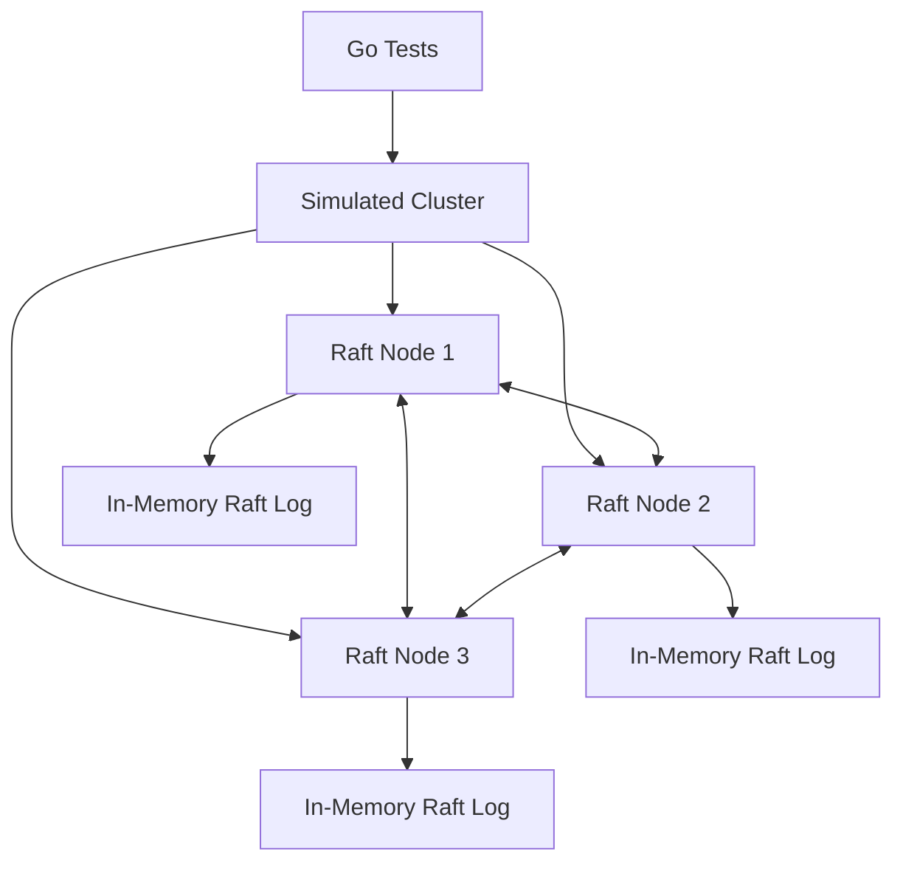
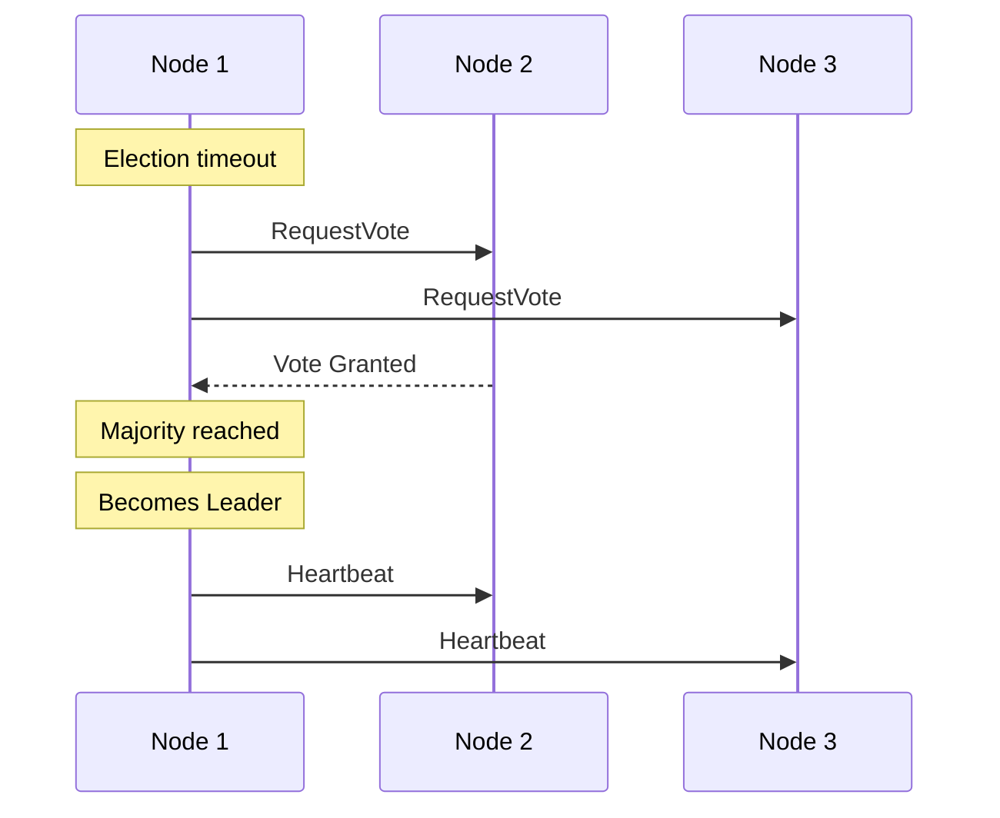
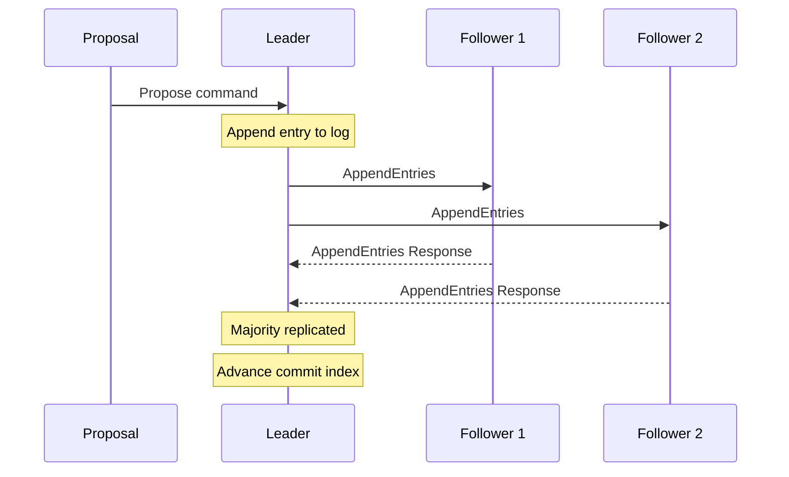
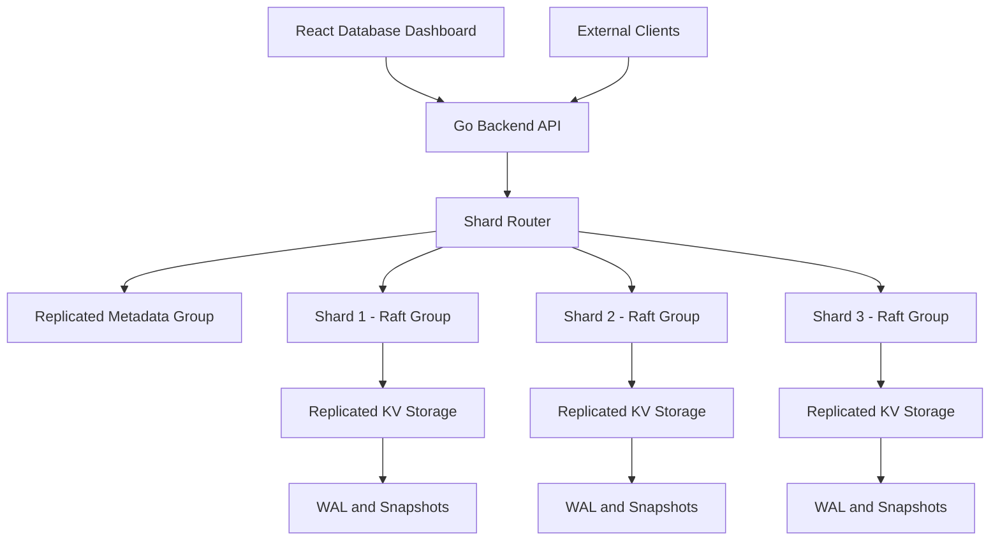
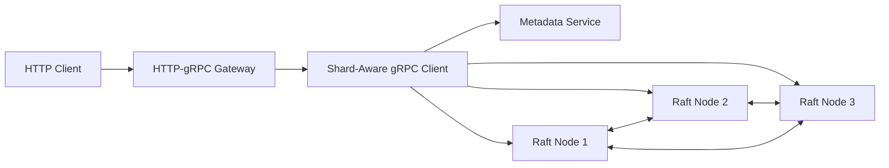

# ShardRAFT

### Building a Fault-Tolerant Distributed Key-Value Database

**Project Status:** Active Development — Raft Consensus, Durable Storage, Recovery, and Fault Testing Implemented

**Team Members:** Krish Shah, Hetansh Patel, Sri Veda 

---

## 1. Overview

ShardRAFT is a distributed database project designed to explore how multiple machines can coordinate, replicate data, recover from failures, and maintain strong consistency. The project is currently in active development, focusing on a custom implementation of the Raft consensus algorithm built in Go.

The long-term goal is to build a complete distributed key-value database featuring:

- Leader-based consensus and replication
- Automatic leader election and failover
- Replicated key-value storage
- Durable write-ahead logging
- Crash recovery and snapshots
- Hash-based data sharding
- Distributed request routing
- Client-facing backend APIs
- A web-based database management dashboard
- Fault injection and consistency verification

Unlike a database that simply connects to an existing storage service, ShardRAFT aims to implement and demonstrate the core mechanisms of a distributed database.

### Current implementation status

ShardRAFT currently implements a Go-based Raft consensus engine, an in-memory
cluster simulator, write-ahead logging (WAL), a key-value state machine,
snapshots, log compaction, and crash recovery.

The implementation includes leader election, majority-based log commitment,
follower catch-up, replication request correlation, and safety invariants.

Testing covers simulated network partitions, selective message loss,
delayed and reordered replication responses, restart recovery,
and deterministic randomized fault workloads.

**Important:** ShardRAFT implements real networking, HTTP and gRPC APIs,
a React dashboard, metadata discovery, and shard-aware client routing.
Physical sharding is implemented through the optional multi-Raft deployment mode. The current tests do not constitute
a proof of correctness under all possible failures.

---

## 2. Problem Statement

Traditional single-node databases depend on one machine for storing and serving data.

If that machine fails, the database may become unavailable. If its data has not been safely persisted or replicated, information may also be lost.

Distributed databases address these problems by maintaining copies of data across multiple machines.

However, replication introduces difficult challenges:

1. How do multiple nodes agree on the current leader?
2. How can replicas maintain a consistent ordering of operations?
3. What happens when a follower misses log entries?
4. How should a cluster react when a leader becomes unavailable?
5. How can the system prevent outdated leaders from making conflicting decisions?
6. How can acknowledged writes survive crashes?
7. How can data be partitioned and distributed across multiple Raft groups?

ShardRAFT addresses these challenges through consensus-based replication, with Raft serving as the foundation for the future database.

---

## 3. Project Objectives

The primary objectives of ShardRAFT are:

### Consensus

Implement Raft leader election, log replication, and commit tracking without relying on an external Raft library.

### Fault Tolerance

Allow a replicated group to elect a new leader when the previous leader becomes unavailable, provided a majority of nodes can communicate.

### Consistency

Maintain a consistent sequence of committed operations across replicas.

### Durability

Eventually persist Raft state, logs, and database records so that nodes can recover after restarting.

### Partitioning

Divide the key space into shards and manage each shard through its own Raft replication group.

### Observability

Provide tools for inspecting cluster state, database contents, replication progress, and failure recovery.

### Evaluation

Measure throughput, latency, recovery time, and correctness under controlled workloads and failure scenarios.

---

## 4. Technology Stack

### Currently used

| Technology | Purpose |
|---|---|
| Go | Raft implementation and cluster simulation |
| Go testing framework | Unit and integration tests |
| Go race detector | Detecting data races during tests |
| Git | Version control |
| GitHub | Source code hosting |
| In-memory state | Raft state and cluster simulation |
| Write-ahead logging (WAL) | Durable Raft state and log storage |
| Key-value state machine | Applying committed database operations |
| Snapshots and log compaction | State recovery and bounded log history |
| Deterministic fault injection | Simulating message loss, delays, and reordering |

### Planned technologies

| Technology | Intended purpose |
|---|---|
| React | Web-based database dashboard |
| TypeScript | Frontend development |
| Go HTTP API | Client-facing backend operations |
| gRPC / Protocol Buffers | Communication between distributed nodes |
| BadgerDB or BoltDB | Embedded key-value storage |
| Docker | Containerized deployment |
| Docker Compose | Multi-node local deployment |
| Prometheus / Grafana | Metrics and monitoring |
| YCSB-style workloads | Performance evaluation |
| Porcupine | Linearizability checking |

These planned technologies are architectural options. Their final selection and integration will be determined during later development.

---

## 5. Current System Architecture

The current implementation focuses on Raft consensus and simulated communication between nodes.



The simulated cluster controls logical time and message delivery.

Each Raft node maintains its own state, including:

- Current term
- Current role
- Vote information
- Replicated log
- Commit index
- Outgoing messages
- Follower replication progress

The simulator allows multiple nodes to interact without requiring separate operating-system processes or network connections.

This is useful for developing and testing consensus behavior before introducing real networking.

---

## 6. Raft Consensus Algorithm

Raft is a consensus algorithm that allows a group of nodes to agree on an ordered sequence of operations.

It organizes consensus around a leader.

The leader coordinates replication, while followers receive and validate log entries.

ShardRAFT currently implements the fundamental Raft roles and replication mechanisms.

### 6.1 Raft Node Roles

Every Raft node operates in one of three roles.

#### Follower

A follower:

- Receives messages from the leader.
- Responds to voting requests.
- Accepts valid log entries.
- Maintains its local replicated log.
- Can start an election when its election timeout expires.

#### Candidate

A candidate:

- Starts a new election.
- Increases the election term.
- Requests votes from other nodes.
- Becomes leader after receiving a majority.

#### Leader

A leader:

- Coordinates replication.
- Accepts proposed commands.
- Sends AppendEntries messages.
- Tracks follower replication progress.
- Determines which entries can be committed.
- Sends heartbeats to followers.

### 6.2 Leader Election

When a follower does not receive leader communication within its election timeout, it may become a candidate.

The candidate requests votes from other nodes.

In a three-node cluster, two votes form a majority.



ShardRAFT includes leader-election tests using a three-node cluster.

### 6.3 Terms

Raft uses terms to identify election periods.

Each term represents a logical epoch.

Terms help nodes distinguish newer leaders from outdated ones.

Messages from older terms can be rejected, preventing stale leaders from controlling the cluster.

### 6.4 Heartbeats

The leader periodically sends heartbeat messages to followers.

Heartbeats communicate that the leader is active.

They also help followers learn updated commit information.

If followers stop receiving valid leader communication, they may eventually start a new election.

---

## 7. Raft Log Replication

Log replication ensures that followers receive the operations proposed through the leader.

Each log entry contains information such as:

| Field | Description |
|---|---|
| Index | Position of the entry |
| Term | Term associated with the entry |
| Type | Normal command or no-op |
| Data | Command payload |

### 7.1 Command Proposal

The current Raft implementation supports proposing command bytes through the leader.

For example:

```go
err := leader.Propose([]byte("SET x=10"))
```

This creates a log entry containing the proposed command.

At this stage, the command is replicated as data in the Raft log. It is not yet applied through a complete persistent key-value database engine.

### 7.2 AppendEntries

The leader sends AppendEntries messages to followers.

These messages include:

- Current term
- Leader identity
- Previous log index
- Previous log term
- Entries to replicate
- Leader commit index
- Request identifier

The follower checks whether the previous log position matches its local log.

If the log prefix is valid, the follower can accept the entries.

Otherwise, it rejects the request.

### 7.3 Replication Example



This diagram represents the consensus replication flow.

The database mutation API waits for the committed operation to be applied before returning a successful result.

---

## 8. Majority-Based Commit

Raft uses majority agreement to determine whether log entries can be committed.

For a three-node Raft group:

- One node is not a majority.
- Two nodes form a majority.
- Three nodes represent the complete group.

The leader tracks follower replication progress and uses Raft's commit rules to advance the commit index.

ShardRAFT includes tests for:

- Majority-based commit.
- Preventing premature commit.
- Committing current-term entries.
- Handling entries inherited from previous terms.

### Current-Term Commit Rule

A Raft leader cannot directly commit an entry from an older term merely by counting replicas.

Instead, it commits a qualifying current-term entry.

This can also establish commitment of preceding entries.

ShardRAFT implements leader no-op entries and tests this behavior.

---

## 9. Leader No-Op Entries

When a node becomes leader, the current implementation appends a no-op entry in its term.

A no-op entry participates in the Raft log but does not represent a user database modification.

For example:

| Index | Term | Type |
|---|---|---|
| 1 | 1 | Normal |
| 2 | 2 | No-op |

The current-term no-op helps establish a commit point under Raft's commitment rules.

This is especially important when a newly elected leader inherits entries from an earlier term.

ShardRAFT contains tests for this behavior.

---

## 10. Follower Catch-Up and Log Conflict Handling

Followers may fall behind because of delayed messages, missed replication requests, or temporary unavailability.

Raft uses log consistency checks and retries to bring followers up to date.

### Example

Suppose the leader contains:

```text
Leader:
Index:  1  2  3  4
Entry:  A  B  C  No-op
```

But the follower contains:

```text
Follower:
Index:  1
Entry:  A
```

The leader may initially assume the follower has more entries than it actually does.

The follower rejects the AppendEntries request when the previous log entry is missing.

The leader then adjusts its replication position and retries.

Eventually, the leader finds a matching prefix and sends the missing entries.

### Tested Behavior

ShardRAFT includes `TestLaggingFollowerCatchesUp`.

During development, the test demonstrated the following sequence:

```text
RequestID=1  reject=true   index=3
RequestID=3  reject=true   index=2
RequestID=4  reject=false  index=4
```

This shows the leader retrying with earlier log positions until the follower can accept the missing entries.

The test ultimately passed, verifying follower catch-up in this simulated scenario.

### Additional Safety Checks

The implementation also tests:

- Rejection of malformed log entries.
- Previous-index and previous-term validation.
- Preservation of valid log suffixes.
- Protection against overwriting committed entries.
- Prevention of commit-index regression.

---

## 11. AppendEntries RequestID Correlation

One of the recent improvements to ShardRAFT is request-response correlation for AppendEntries.

### The Problem

Distributed messages can be delayed, duplicated, or delivered out of order.

Without request correlation, a leader may incorrectly associate a response with the wrong replication request.

This can corrupt its understanding of follower progress.

### The Solution

ShardRAFT assigns unique request identifiers to outgoing AppendEntries requests.

For example:

```text
Leader -> Follower

AppendEntries
RequestID = 17
```

The follower includes the same identifier in its response:

```text
Follower -> Leader

AppendEntriesResponse
RequestID = 17
```

The leader checks whether the response corresponds to an outstanding request.

Unknown or already-consumed request IDs are ignored.

### Current Implementation

The Raft implementation tracks:

```go
nextRequestID uint64
```

and pending AppendEntries requests associated with followers.

Responses are checked against recorded request information before updating replication progress.

### Important Limitation

RequestID correlation is not equivalent to message authentication.

It also does not automatically solve every message-reordering scenario.

Further work is planned to improve pending-request tracking across leadership transitions and more complex reordered responses.

---

## 12. Replication Progress Tracking

The leader maintains replication progress for followers.

Two important structures are:

### nextIndex

The next log index the leader plans to send to a follower.

```go
nextIndex map[NodeID]uint64
```

### matchIndex

The highest log index the leader believes a follower has successfully replicated.

```go
matchIndex map[NodeID]uint64
```

These structures help the leader:

- Determine where replication should resume.
- Retry rejected AppendEntries requests.
- Track successful acknowledgments.
- Determine whether entries have reached a majority.

The implementation includes tests covering acknowledgment handling and progress tracking.

---

## 13. Cluster Simulation

ShardRAFT includes an in-memory simulation layer for running multiple Raft nodes.

The simulator allows tests to:

- Create a cluster.
- Advance logical time.
- Trigger elections.
- Deliver Raft messages.
- Submit proposals.
- Observe replication and commitment.

### Example

```go
cluster := NewCluster([]raft.NodeID{1, 2, 3})
```

The simulator is useful because consensus behavior can be tested without requiring real network infrastructure.

### Three-Node Election Test

The project includes a test that creates three nodes and checks whether the cluster elects exactly one leader.

### Three-Node Replication Test

The project also includes `TestThreeNodeReplication`.

The test:

1. Creates a three-node cluster.
2. Advances the simulation.
3. Identifies the elected leader.
4. Proposes a command.
5. Delivers AppendEntries requests and responses.
6. Verifies majority-based commitment.

These tests provide early integration evidence for the consensus implementation.

---

## 14. Project Structure

The currently discussed repository layout is:

```text
ShardRAFT/
|
|-- cmd/
|   |-- shardraft/
|       |-- Go command entry point
|
|-- internal/
|   |
|   |-- raft/
|   |   |-- raft.go
|   |   |-- replication.go
|   |   |-- types.go
|   |   |-- replication_test.go
|   |   |-- Additional Raft implementation and tests
|   |
|   |-- meta/
|   |   |-- slot.go
|   |   |-- shardmap.go
|   |   |-- statemachine.go
|   |   |-- Slot, shard map and metadata tests
|   |
|   |-- shard/
|   |   |-- router.go
|   |   |-- group.go
|   |   |-- dispatcher.go
|   |   |-- Existing shard implementation and tests
|   |
|   |-- simnet/
|       |-- Cluster simulation implementation
|       |-- cluster_test.go
|
|-- go.mod
|
|-- README.md
```

### internal/raft

Contains the Raft consensus implementation.

Responsibilities include:

- Node state
- Elections
- Voting
- Heartbeats
- Log replication
- Commit tracking
- Request-response handling

### internal/meta

Contains the sharding and metadata primitives.

Responsibilities include:

- Deterministic key-to-slot hashing
- The versioned shard map and its validation
- The metadata state machine for shard map updates
- Shard map snapshot and restore

### internal/shard

Contains the existing shard implementation and the routing additions.

Responsibilities include:

- Mapping keys to their slot, owning group, and replicas
- Typed wrong-shard ownership checks
- An ownership-enforcing group wrapper around a shard
- A dispatcher that routes requests to the local owning group

### internal/simnet

Contains the simulated cluster environment.

Responsibilities include:

- Managing simulated nodes
- Advancing logical time
- Delivering messages
- Supporting integration tests

### cmd/shardraft

Contains the command package for the project.

The current CLI interface is not yet documented as a supported database server interface.

---

## 15. Getting Started

### Prerequisites

Install:

- Go
- Git
- A terminal
- VS Code or another code editor

### Clone the Repository

```bash
git clone https://github.com/KrishShah1912/shardraft.git
```

Enter the project directory:

```bash
cd shardraft
```

### Verify Go Installation

```bash
go version
```

### Download Module Dependencies

```bash
go mod download
```

### Build the Project

```bash
go build ./...
```

The build should complete without errors.

**Note:** ShardRAFT now supports a local three-node database cluster and an interactive React dashboard. Run `cd web && npm ci` to install frontend dependencies, then run `make dev` from the repository root. Open http://localhost:5173 to access the dashboard.

---

## 16. Testing

Testing is a major part of ShardRAFT's development process.

### Run All Tests

```bash
go test -count=1 ./...
```

This runs the project's Go test packages.

### Run Raft Tests

```bash
go test -count=1 ./internal/raft
```

### Run Simulation Tests

```bash
go test -count=1 ./internal/simnet
```

### Run Tests with Verbose Output

```bash
go test -v ./...
```

### Run a Specific Test

For follower catch-up:

```bash
go test -count=1 -run '^TestLaggingFollowerCatchesUp$' -v ./internal/raft
```

### Run the Race Detector

```bash
go test -race ./...
```

The race detector helps identify certain concurrent memory-access errors.

### Run Static Analysis

```bash
go vet ./...
```

### Format Go Code

```bash
go fmt ./...
```

### Build All Packages

```bash
go build ./...
```

### Latest Verified Results

At the latest reported verification, the following commands passed:

| Command | Result |
|---|---|
| `go test -count=1 ./...` | Passed |
| `go test -race -count=1 ./...` | Passed |
| `go vet ./...` | Passed |
| `go build ./...` | Passed |
| `go test -tags=stress -count=1 -run '^TestExtendedRaftStress$' ./internal/raftdriver` | Passed |
| `go test -tags=stress -race -count=1 -run '^TestExtendedRaftStress$' ./internal/raftdriver` | Passed |

These results demonstrate that the tested implementation works for the covered scenarios.

They do not establish correctness under every possible distributed-system failure.

---

## 17. Current Test Coverage

The Raft tests developed so far cover scenarios including:

| Test | Purpose |
|---|---|
| `TestLeaderProposesCommand` | Leader proposal handling |
| `TestLeaderSendsAppendEntries` | Outgoing replication requests |
| `TestFollowerAcceptsAppendEntries` | Follower log acceptance |
| `TestDuplicateAppendPreservesSuffix` | Duplicate append behavior |
| `TestLeaderTracksFollowerAcknowledgment` | Replication progress tracking |
| `TestLeaderCommitsAfterMajority` | Majority-based commitment |
| `TestLeaderDoesNotDirectlyCommitOldTermEntry` | Raft commit safety |
| `TestLeaderRetriesRejectedAppend` | Rejection and retry behavior |
| `TestLaggingFollowerCatchesUp` | Missing-entry replication |
| `TestMalformedAppendDoesNotModifyLog` | Invalid log protection |
| `TestFollowerRejectsCommittedEntryOverwrite` | Committed-entry safety |
| `TestDelayedRejectionDoesNotMoveProgressBackward` | Delayed-response handling |
| `TestLeaderCommitsInheritedEntryThroughNoop` | Current-term no-op commitment |
| `TestFollowerCommitIndexNeverDecreases` | Commit-index monotonicity |
| `TestFollowerLearnsCommitThroughHeartbeat` | Heartbeat commit propagation |
| `TestHeartbeatDoesNotCommitConflictingLog` | Conflicting-log protection |
| `TestUnsentAppendResponseDoesNotAdvanceMatchIndex` | Unknown-response rejection |
| `TestThreeNodeElection` | Cluster leader election |
| `TestThreeNodeReplication` | Cluster replication and commit |

Additional verified test coverage includes:

- End-to-end replication with dropped acknowledgments
- Delayed and reverse-order replication responses
- Majority commitment despite an unavailable acknowledgment
- Eventual follower recovery after network restoration
- Committed-log consistency and Raft invariant checking
- WAL persistence and crash recovery
- KV snapshot restoration and log compaction
- Deterministic randomized fault testing

Sharding and metadata test coverage includes:

- A key always maps to the same slot, within range
- Every slot has exactly one owner, with correct boundaries
- Keys spread across all four shards
- Shard map validation of gaps, overlaps, invalid ranges and replicas
- A deterministic metadata state machine
- Rejection of stale, non-consecutive, invalid and unknown commands
- Metadata snapshot and restore
- Key routing to the owning group and typed wrong-shard errors
- Ownership that follows shard map updates
- Dispatch to the local owning group and not-local errors

The extended stress test exercises 100 seeds with 100 operations per seed.
These tests cover selected failure scenarios rather than every possible
distributed-system execution.

Additional tests will be introduced as the system expands.

---

## 18. Planned Complete Database Architecture

The long-term ShardRAFT architecture extends beyond the current Raft simulator.



This is the planned architecture, not the currently deployed system.

### Main Components

#### Frontend

A browser-based dashboard for database operations and cluster monitoring.

#### Backend API

A Go service that accepts client requests and routes them to the appropriate database shard.

#### Shard Router

Determines which shard owns a particular key.

#### Metadata Group

Maintains shard placement and cluster routing information.

#### Raft Groups

Coordinate replicated operations within individual shards.

#### Storage Engine

Applies committed operations to durable key-value data.

#### Recovery Layer

Restores node state using persisted logs and snapshots.

---

## 19. Database Operations

The current database supports common key-value operations.

### PUT / SET

Store or update a value.

```text
SET user:101 {"name":"Alex"}
```

### GET

Retrieve a value.

```text
GET user:101
```

### DELETE

Remove a key.

```text
DELETE user:101
```

### Compare-and-Swap

Conditionally update a key if its current value or version matches an expected value.

These operations are exposed through the current HTTP backend API.

### Planned Write Flow

1. Client submits a write.
2. Backend identifies the correct shard.
3. Request reaches the shard leader.
4. Leader appends the operation to its Raft log.
5. Replicas persist the operation.
6. The Raft group reaches a majority.
7. The operation becomes committed.
8. The committed operation is applied to the key-value state machine.
9. The client receives a successful response.

This flow describes the intended durable database behavior.

### Planned Read Flow

1. Client requests a key.
2. Backend determines the owning shard.
3. Request reaches the appropriate replica.
4. The system performs the consistency checks required by the selected read mode.
5. The stored value is returned.

Quorum-confirmed linearizable reads are implemented through the internal shard ReadIndex API. The existing HTTP GET endpoint does not yet use this mechanism.

---

## 20. Planned Data Sharding

The architecture divides the key space into **65,536 logical hash slots**.

Each key maps deterministically to a slot.

Each shard owns a contiguous range of slots.

The four-shard layout and its replica placement are:

| Shard | Slot range | Replicas |
|---|---|---|
| Shard 1 | 0–16383 | n1, n2, n3 |
| Shard 2 | 16384–32767 | n2, n3, n4 |
| Shard 3 | 32768–49151 | n3, n4, n5 |
| Shard 4 | 49152–65535 | n4, n5, n1 |

A separate metadata group (replicas n1, n2, n3) holds the shard map.

### Implemented Sharding Components

The in-process sharding and metadata primitives are implemented and
tested in `internal/meta` and `internal/shard`:

- **Slot mapping** — `SlotForKey` hashes a key with CRC32 IEEE modulo
  65,536, deterministically and stably.
- **Shard map** — a versioned `ShardMap` with validation that enforces
  contiguous ranges with no gaps or overlaps, every slot owned once,
  and valid unique replicas.
- **Metadata state machine** — applies `SET_SHARD_MAP` commands with an
  expected version, requires the new version to be the current version
  plus one, leaves state unchanged on rejection, and supports snapshot
  and restore.
- **Router** — maps a key to its slot, owning group, and replicas.
- **Ownership checks** — a typed wrong-shard error that names the real
  owning group and its replicas.
- **Group** — a wrapper around an existing shard that rejects keys it
  does not own, checking the current map on every call.
- **Dispatcher** — routes each request to the local group owning the
  key, and returns a not-local error with the replica list otherwise.

Live multi-group Raft deployment and wiring these components into the
HTTP and gRPC servers remain planned. See
[Sharding and the Metadata Group](docs/SHARDING.md) for details.

### Why Hash-Based Sharding?

Hash-based partitioning provides:

- Deterministic key placement
- Distribution across shards
- Straightforward request routing
- A foundation for horizontal scaling

A limitation is that hashing does not preserve natural key ordering, making ordered range queries less efficient.

### Replication Per Shard

Each shard is intended to have its own Raft group. The current work
defines the shard map and routing; running a live Raft group per shard
remains planned.

A three-replica group can tolerate one unavailable replica while retaining a majority, assuming the remaining replicas can communicate and have the required durable state.

---

## 21. Planned Fault Tolerance and Recovery

The final database is intended to handle several failure scenarios.

### Leader Failure

If a leader becomes unavailable, the remaining nodes can start an election.

A new leader can be elected if a majority remains available.

### Follower Failure

A follower may temporarily stop receiving log entries.

When it returns, the leader should synchronize the missing entries.

### Process Restart

A restarted node should restore its persisted state and resume participating in replication.

### Network Partition

A partition that does not contain a majority should not continue committing writes.

### Crash Recovery

The planned storage system will use:

- Persistent Raft state
- Write-ahead logging
- Log replay
- Snapshots
- Replica synchronization

These features require additional implementation and testing.

---

## 22. Frontend Dashboard

ShardRAFT includes a React and TypeScript dashboard for database operations, cluster monitoring, and controlled failure experiments.

### Database Explorer

Users will be able to:

- View stored keys
- Inspect values
- Insert records
- Update records
- Delete records
- Search for keys

### Query Console

Users will be able to execute database operations and inspect the responses.

### Cluster Dashboard

The interface will display:

- Active nodes
- Current leaders
- Followers
- Raft terms
- Commit indexes
- Replication progress
- Node availability

### Replication Visualization

The dashboard will help demonstrate how writes propagate through the cluster.

### Failure Simulation

Controlled experiments will allow users to observe:

- Leader failure
- New leader election
- Follower disconnection
- Replica catch-up
- Recovery after restart

### Shard Explorer

Users will be able to inspect which shard owns a particular key.

The frontend will interact with the real backend and database implementation rather than relying on permanently mocked data.

---

## 23. Planned Evaluation

ShardRAFT will be evaluated using several categories.

### Throughput

Measure the number of completed operations per second.

### Latency

Measure request latency, including:

- p50 latency
- p95 latency
- p99 latency

### Fault Recovery

Measure how long the cluster takes to recover from leader or follower failures.

### Replication Correctness

Check that committed operations are preserved and consistently applied.

### Linearizability

Record operation histories and use a checker to detect violations of the intended consistency guarantees.

### Scalability

Compare performance with different numbers of shards and nodes.

### Durability

Test whether acknowledged writes survive supported crash scenarios.

### Workloads

Planned workloads include:

- Read-heavy
- Write-heavy
- Balanced read/write
- Uniform key distribution
- Skewed or hot-key distribution

Preliminary local benchmark results are documented in [Integration Validation](docs/INTEGRATION_VALIDATION.md).

---

## 24. Development Roadmap

### Phase 1 — Raft Foundation

- [x] Initialize the Go project
- [x] Implement Raft node roles
- [x] Implement leader election
- [x] Implement voting
- [x] Implement heartbeats
- [x] Implement command proposals
- [x] Implement AppendEntries
- [x] Implement majority-based commit
- [x] Implement leader no-op entries
- [x] Implement follower replication tracking
- [x] Implement log rejection and retries
- [x] Implement follower catch-up
- [x] Add AppendEntries RequestID correlation
- [x] Add three-node cluster simulation tests

### Phase 2 — Raft Hardening

- [x] Improve handling of reordered replication responses
- [x] Clean up outstanding requests during leadership changes
- [x] Expand election safety tests
- [x] Add more failure and partition scenarios
- [x] Strengthen consensus correctness verification through invariants and randomized testing

### Phase 3 — Persistent Storage

- [x] Implement write-ahead logging
- [x] Persist Raft state
- [x] Build the key-value state machine
- [x] Add snapshots
- [x] Implement crash recovery
- [x] Test data recovery after restart

### Phase 4 — Backend and Networking

- [x] Implement real node-to-node communication
- [x] Run nodes as independent processes
- [x] Build client-facing APIs
- [x] Add request routing
- [x] Handle leader redirection and retries

### Phase 5 — Sharding

- [x] Implement hash-slot partitioning
- [x] Implement the metadata state machine
- [x] Add shard routing logic
- [ ] Introduce multiple live Raft groups
- [ ] Wire routing into the HTTP and gRPC servers
- [ ] Test live data distribution
- [ ] Explore shard rebalancing

### Phase 6 — Frontend

- [x] Build React and TypeScript application
- [x] Create database explorer
- [x] Create query console
- [x] Create cluster monitoring dashboard
- [x] Add replication visualization
- [x] Add failure simulation controls

### Phase 7 — Evaluation and Deployment

- [x] Add deterministic fault-injection experiments
- [ ] Add linearizability checking
- [x] Benchmark throughput and latency
- [x] Measure recovery time
- [ ] Containerize the system
- [ ] Build a multi-node Docker Compose deployment
- [ ] Prepare end-to-end demonstrations

---

## 25. Current Limitations

ShardRAFT is under active development.

The following limitations currently apply:

1. The simulator complements the local HTTP-based cluster but does not reproduce every real network condition.
2. Independent node processes and HTTP transport are implemented for local development; production network hardening remains future work.
3. Client-facing KV APIs and automatic leader routing are implemented for a single Raft group. Multi-shard routing at the server level remains future work.
4. The sharding primitives — slot mapping, the versioned shard map, the metadata state machine, the router, ownership checks, and the dispatcher — are implemented and tested in process. Live multi-group Raft deployment and wiring these components into the HTTP and gRPC servers remain planned.
5. The frontend dashboard is implemented, but unresolved mutation state is not guaranteed to survive page reloads or navigation.
6. Network-based snapshot installation for followers behind the compacted log boundary is not implemented.
7. Crash recovery and persistence are tested for selected scenarios, not every possible failure or storage fault.
8. Exhaustive Raft safety and linearizability verification remain future work.
9. Production performance and scalability benchmarks have not yet been established.

These limitations distinguish the tested implementation from the
intended complete distributed database.

---

## 26. Key Distributed Systems Concepts

| Concept | Meaning |
|---|---|
| Consensus | Agreement among nodes on an ordered sequence of operations |
| Raft | Leader-based distributed consensus algorithm |
| Leader | Node coordinating replication |
| Follower | Node receiving and validating replicated entries |
| Candidate | Node requesting votes during an election |
| Term | Logical election epoch |
| Log Entry | Indexed operation stored in the Raft log |
| Quorum | Majority of nodes in a Raft group |
| Commit Index | Highest committed log index |
| nextIndex | Next log index to send to a follower |
| matchIndex | Highest index known to be replicated on a follower |
| No-op | Entry that does not modify application data |
| Sharding | Partitioning data across multiple groups |
| WAL | Write-ahead log used for durability |
| Snapshot | Saved state used for recovery and log compaction |
| Linearizability | Consistency model where operations appear atomic in real-time order |
| Failover | Transition to another available node after failure |
| State Machine | Logic applying committed operations to application data |

---

## 27. Project Background

ShardRAFT originated as a group project for **CSE 512 — Distributed Database Systems** at Arizona State University.

The project explores fault-tolerant distributed storage through consensus-based replication, data partitioning, failure recovery, and consistency verification.

The original proposal describes a larger multi-shard distributed key-value database.

Development is being carried out incrementally, with the Raft consensus implementation serving as the initial foundation.

The project emphasizes understanding and testing distributed-systems behavior rather than treating consensus as a black box.

---

## 28. References

1. Ongaro, D., and Ousterhout, J. (2014). *In Search of an Understandable Consensus Algorithm.* USENIX Annual Technical Conference.  
   https://raft.github.io/raft.pdf

2. Raft Consensus Algorithm — Official Resources.  
   https://raft.github.io/

3. Kleppmann, M. *Designing Data-Intensive Applications.*

4. Jepsen — Distributed Systems Safety Research.  
   https://jepsen.io/

5. Cooper, B. F., et al. (2010). *Benchmarking Cloud Serving Systems with YCSB.*

6. Gilbert, S., and Lynch, N. (2002). *Brewer's Conjecture and the Feasibility of Consistent, Available, Partition-Tolerant Web Services.*

---

## 29. Final Vision

ShardRAFT aims to evolve from a tested Raft consensus prototype into a complete distributed key-value database.

The intended system will combine:

- Consensus-based replication
- Persistent key-value storage
- Automatic leader election
- Fault tolerance and recovery
- Hash-based sharding
- Distributed request routing
- Backend APIs
- A web-based management dashboard
- Performance and correctness evaluation

The goal is to make distributed database behavior understandable, observable, and verifiable through a working implementation.

---

**ShardRAFT — Building Distributed Database Systems One Consensus Decision at a Time.**


## Implementation and Validation Documentation

- [Request Routing and Leader Redirection](docs/REQUEST_ROUTING.md)
- [Integration Validation and Benchmark Results](docs/INTEGRATION_VALIDATION.md)
- [Sharding and the Metadata Group](docs/SHARDING.md)
- [Development Checklist](docs/CHECKLIST.md)

## ReadIndex and Linearizable Reads

ShardRAFT implements quorum-confirmed linearizable reads
through its internal shard API.

- Current-term commit requirement.
- Correlated heartbeat quorum confirmation.
- Applied-index safety barrier.
- Concurrent reads, cancellation, and bounded deadlines.
- Leadership-change and recovery protection.
- No additional Raft log entry for each read.

The public shard API is `GetLinearizable(ctx, key)`.
The existing local `Get` API remains available.

Client-facing gRPC KV integration is implemented.
The existing daemon HTTP GET endpoint is unchanged.
The standalone HTTP-gRPC gateway provides linearizable
GET requests by default.

See [ReadIndex architecture and validation](docs/READ_INDEX.md)
for implementation details, safety guarantees, and test commands.


## gRPC Metadata and Client Routing

Steps 7.19 and 7.20 implement:

- gRPC metadata discovery.
- CRC32 logical hash-slot calculation.
- Thread-safe metadata caching.
- Reusable gRPC connections.
- Leader-aware request routing.
- Metadata refresh on WRONG_SHARD.
- Bounded retries and stable mutation identities.
- Default linearizable reads.
- Unified GET, PUT, DELETE, and CAS operations.

The current deployment contains one Raft group owning all
65,536 logical hash slots.

### Final Validation

| Validation | Result |
|---|---|
| Unified client tests | 14/14 passed |
| Repeated client tests | 700/700 passed |
| Distributed integration tests | 12/12 passed |
| Repeated distributed tests | 120/120 passed |
| Combined client statement coverage | 93.9% |
| Backend package test executions | 42/42 passed |
| Frontend unit tests | 25/25 passed |
| Backend and frontend builds | Passed |
| Static analysis and module verification | Passed |

Browser E2E tests were not rerun for this milestone.

### Documentation

- [gRPC KV Service](docs/GRPC_KV_SERVICE.md)
- [gRPC Metadata Service](docs/GRPC_METADATA_SERVICE.md)
- [Shard-Aware gRPC Client](docs/GRPC_CLIENT.md)

Physical sharding, multiple Raft groups, dynamic ownership,
and shard rebalancing remain future work.

## HTTP-gRPC Gateway

Step 7.21 introduces a standalone HTTP-gRPC gateway
backed by the shard-aware gRPC client.

### Implemented Features

- HTTP GET, PUT, DELETE, and compare-and-swap.
- Automatic metadata discovery and leader-aware routing.
- Default quorum-confirmed linearizable reads.
- Explicit local reads.
- Strict JSON request validation.
- Bounded retries and request deadlines.
- Stable mutation identities and durable deduplication.
- Structured HTTP error responses.
- Committed request conflict confirmation.
- Graceful shutdown and independent gateway restart.

### Architecture



The gateway is an additional client-facing service.
The existing daemon HTTP API and React dashboard
remain unchanged.

### Build and Run

Build the gateway from the repository root:

```bash
mkdir -p bin
go build -o bin/shardraft-gateway ./cmd/shardraft-gateway
```

With a compatible gRPC-enabled ShardRAFT cluster running:

```bash
./bin/shardraft-gateway \
  -http-addr 127.0.0.1:8085 \
  -grpc-endpoints 127.0.0.1:9091,127.0.0.1:9092,127.0.0.1:9093 \
  -request-timeout 11s
```

### Supported HTTP Operations

| Method | Endpoint | Operation |
|---|---|---|
| GET | `/kv/{key}` | Linearizable read by default |
| PUT | `/kv/{key}` | Insert or update |
| DELETE | `/kv/{key}` | Delete |
| POST | `/kv/{key}/cas` | Compare-and-swap |

All mutations require a client_id and request_id.
Retries must preserve the original mutation identity
and operation contents.

Explicit local reads are available through
`?read_mode=local` and may return stale data.

### Gateway Validation

| Validation | Result |
|---|---|
| Gateway test functions | 78 |
| Gateway unit test functions | 59 |
| Distributed test functions | 19 |
| Distributed baseline | 19/19 passed |
| Distributed shuffled stress | 95/95 passed |
| Distributed race validation | 57/57 passed |
| Complete gateway suite | 78/78 passed |
| Total distributed executions | 190/190 passed |
| Gateway unit statement coverage | 95.5% |
| gRPC client statement coverage | 92.5% |
| Backend package regression | Passed |
| Backend package race regression | Passed |
| Build and static analysis | Passed |
| Module and dependency validation | Passed |

Distributed tests cover:

- Bootstrap discovery through a follower.
- CRUD, CAS, and read consistency modes.
- Leader failover and durable request deduplication.
- Conflicting request identities.
- Quorum loss and recovery.
- Concurrent mutations and replica convergence.
- Complete backend unavailability and recovery.
- Independent gateway restart.
- Historical mutation replay after gateway restart.

The distributed fixture uses three independent daemon
processes, real network connections, and isolated
temporary persistent storage.

### Compatibility and Limitations

The gateway preserves existing HTTP endpoints and
gRPC service methods. The conflict_committed field
is an additive protobuf extension.

The current deployment contains one Raft group owning
all 65,536 logical hash slots.

Physical multi-shard deployment, dynamic shard migration,
production security hardening, and exhaustive consistency
verification remain future work.

Browser E2E tests were not rerun for this milestone.

See [HTTP-gRPC Gateway](docs/HTTP_GRPC_GATEWAY.md)
for configuration, API examples, architecture,
error handling, and reproducible validation commands.

## gRPC Command-Line Client

Step 7.22 introduces a standalone command-line client backed
by the shard-aware gRPC client.

### Implemented Features

- GET, PUT, DELETE, and compare-and-swap.
- Automatic metadata discovery and leader-aware routing.
- Linearizable reads by default and explicit local reads.
- JSON and human-readable text output.
- Configurable bootstrap endpoints and operation deadlines.
- Automatic and explicit mutation identities.
- Durable deduplication and uncertain mutation recovery.
- Structured exit codes and graceful cancellation.

### Build and Usage

```bash
mkdir -p bin
go build -o bin/shardraft ./cmd/shardraft

./bin/shardraft --help
./bin/shardraft put balance 100
./bin/shardraft get balance
./bin/shardraft cas balance 100 200
./bin/shardraft delete balance
```

These operations require a running gRPC-enabled cluster.

### CLI Validation

| Validation | Result |
|---|---|
| Unit test functions | 127 |
| Distributed test functions | 30 |
| Final distributed normal executions | 150/150 passed |
| Final distributed race executions | 60/60 passed |
| CLI unit statement coverage | 98.1% |
| Final repository package regression | 17/17 passed |
| Build, static analysis, and module verification | Passed |

Distributed validation covers CRUD, CAS, bootstrap discovery,
leader failover, durable deduplication, quorum loss, recovery,
and concurrent operations.

The existing backend, gateway, protobuf contracts, and Go
module dependencies remain unchanged by this milestone.

Physical multi-shard deployment remains future work.

See [ShardRAFT gRPC CLI](docs/GRPC_CLI.md) for configuration,
command examples, exit codes, mutation recovery, and limitations.

## Final gRPC Integration Acceptance

The gRPC CLI, HTTP gateway and legacy daemon HTTP GET
interface have been validated against the same isolated
three-node cluster.

Cross-interface mutation replay and identity conflict
handling passed without additional committed entries.

See [gRPC Integration Acceptance](docs/GRPC_ACCEPTANCE.md)
for the final results, acceptance scope and limitations.

Physical multi-shard execution remains part of Step 8.

## Multi-Raft Sharding and Metadata

ShardRAFT supports five storage nodes, four independent
data-shard Raft groups and one replicated metadata group.

- 65,536 deterministic hash slots.
- Three replicas per data shard.
- Persistent, versioned metadata.
- Automatic shard-map discovery.
- Shard-aware KV request routing.
- Linearizable reads and mutation deduplication.
- Successful end-to-end validation across all four shards.

Multi-Raft mode is enabled with the `-multi-raft` flag.
The existing single-shard mode remains available.

See [Multi-Raft Acceptance](docs/MULTI_RAFT_ACCEPTANCE.md)
for implementation details, validation results and limitations.

## Local Docker Deployment

ShardRAFT supports a local Docker Compose deployment
with five multi-Raft storage nodes, two HTTP gateways,
independent persistent volumes and storage health checks.

Start the deployment:

```bash
docker compose up -d --build --wait
docker compose ps
```

Gateway endpoints:

- Gateway 1: `http://127.0.0.1:18091`
- Gateway 2: `http://127.0.0.1:18092`

The deployment includes a host-side `chaosctl` CLI
and opt-in Docker integration and fault tests.

See [Local Deployment Guide](docs/DEPLOYMENT.md)
for configuration, usage, validation and limitations.
