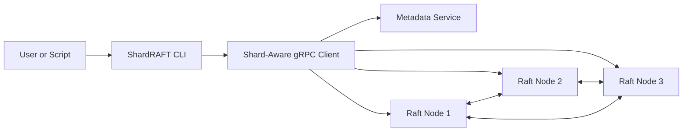

# ShardRAFT gRPC Command-Line Client

## Overview

The ShardRAFT CLI provides direct access to the distributed
key-value store through the shard-aware gRPC client.

It supports GET, PUT, DELETE, and compare-and-swap operations,
automatic metadata discovery, leader-aware routing, bounded
retries, and stable mutation identities.

## Architecture



The CLI communicates directly with the gRPC services.
It does not require the HTTP-gRPC gateway.

## Build

From the repository root:

```bash
mkdir -p bin
go build -o bin/shardraft ./cmd/shardraft
./bin/shardraft --help
```

A compatible gRPC-enabled cluster must be running before
executing key-value operations.

## Configuration

| Flag | Default | Description |
|---|---|---|
| --grpc-endpoints | 127.0.0.1:9091,127.0.0.1:9092,127.0.0.1:9093 | Bootstrap endpoints |
| --timeout | 11s | Overall operation deadline |
| --output | json | JSON or text output |
| --client-id | Generated | Mutation client identity |
| --request-id | Generated | Mutation request identity |

Global flags must appear before the command.

Explicit request IDs require an explicit client ID.
Mutation identity flags are not supported by GET.

## Commands

### PUT

```bash
./bin/shardraft put balance 100
```

### GET

```bash
./bin/shardraft get balance
```

GET uses quorum-confirmed linearizable reads by default.

### Local GET

```bash
./bin/shardraft get --local balance
```

Local reads may return stale data.

### Compare-and-swap

```bash
./bin/shardraft cas balance 100 200
```

The mutation is applied only when the expected value matches
the current value.

A CAS mismatch is a successful command execution with
applied=false.

### DELETE

```bash
./bin/shardraft delete balance
```

### Custom configuration

```bash
./bin/shardraft \
  --grpc-endpoints 127.0.0.1:9092,127.0.0.1:9093 \
  --timeout 15s \
  --output text \
  get balance
```

### Special arguments

Quote values containing spaces or shell-sensitive characters.

Use -- before positional arguments beginning with a dash.

```bash
./bin/shardraft put -- -key "example value"
```

Keys must be non-empty valid UTF-8 strings.
Empty values are supported.

## Output Contracts

JSON is the default output format.

A successful GET response contains:

```json
{
  "key": "balance",
  "value": "100",
  "found": true,
  "read_mode": "linearizable"
}
```

A successful mutation response contains:

```json
{
  "operation": "put",
  "key": "balance",
  "value": "100",
  "applied": true,
  "client_id": "example-client",
  "request_id": "example-request"
}
```

Mutation responses preserve the operation identity.

Normal results are written to stdout.
Errors are written to stderr.

## Exit Codes

| Code | Meaning |
|---|---|
| 0 | Successful execution or help |
| 1 | Operation, initialization, or output failure |
| 2 | Invalid arguments or configuration |
| 3 | GET key not found |
| 4 | Mutation outcome unknown |

A missing GET key returns exit code 3.

CAS mismatches are not execution failures.

## Mutation Identity and Recovery

The CLI generates mutation identities when they are not
explicitly supplied.

For recoverable scripted operations, provide stable identities:

```bash
./bin/shardraft \
  --client-id example-client \
  --request-id update-001 \
  put balance 200
```

If the mutation outcome is unknown, retry the same operation
with the original client ID, request ID, key, and value.

```bash
./bin/shardraft \
  --client-id example-client \
  --request-id update-001 \
  put balance 200
```

Do not generate a new request ID when recovering an uncertain
mutation outcome.

The backend uses durable request deduplication to recognize
previously committed requests. Reusing an identity with different
operation contents can produce a request conflict.

Explicit identities are recommended when recovery must survive
abrupt termination of the CLI process.

## Validation

The CLI has been validated using unit tests, fuzz testing,
real distributed daemon processes, and race detection.

| Validation | Result |
|---|---|
| CLI unit test functions | 127 |
| Distributed test functions | 30 |
| Final distributed normal executions | 150/150 passed |
| Final distributed race executions | 60/60 passed |
| Final distributed executions | 210/210 passed |
| CLI unit statement coverage | 98.1% |
| Final repository package regression | 17/17 passed |
| Build and static analysis | Passed |
| Module verification | Passed |
| Process cleanup | Passed |

Distributed scenarios include:

- Bootstrap discovery and endpoint fallback.
- CRUD and compare-and-swap.
- Linearizable and local reads.
- Leader failover and recovery.
- Durable request deduplication.
- Conflicting mutation identities.
- Quorum loss and uncertain mutation recovery.
- Complete backend outage and recovery.
- Concurrent reads and mutations.
- Concurrent identical and conflicting requests.
- Competing compare-and-swap operations.

Distributed tests use real gRPC connections, three independent
daemon processes, and isolated temporary persistent storage.

## Reproducing Essential Validation

```bash
go test ./cmd/shardraft
go test ./internal/client
go build ./...
go vet ./...
```

The optional distributed suite is enabled using
SHARDRAFT_CLI_INTEGRATION=1 and requires the
SHARDRAFT_DAEMON_BINARY and SHARDRAFT_CLI_BINARY environment
variables to identify compatible executable binaries.

## Compatibility and Limitations

The CLI reuses the existing shard-aware client without
changing the protobuf contracts or backend implementation.

The current production deployment contains one Raft group
owning all 65,536 logical hash slots.

Physical multi-shard deployment and dynamic rebalancing
remain future work.

The distributed tests provide regression evidence, not a
formal proof of correctness under every possible failure.

Graceful process failures and recovery are covered.
Exhaustive network partition, abrupt crash, and mixed
concurrent read-write history verification are not claimed.

## Related Documentation

- [Shard-Aware gRPC Client](GRPC_CLIENT.md)
- [gRPC KV Service](GRPC_KV_SERVICE.md)
- [gRPC Metadata Service](GRPC_METADATA_SERVICE.md)
- [HTTP-gRPC Gateway](HTTP_GRPC_GATEWAY.md)
- [Implementation Checklist](CHECKLIST.md)
