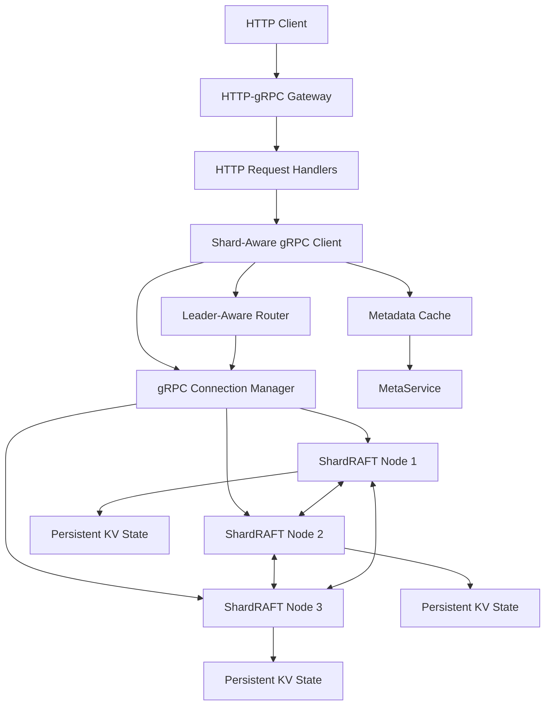
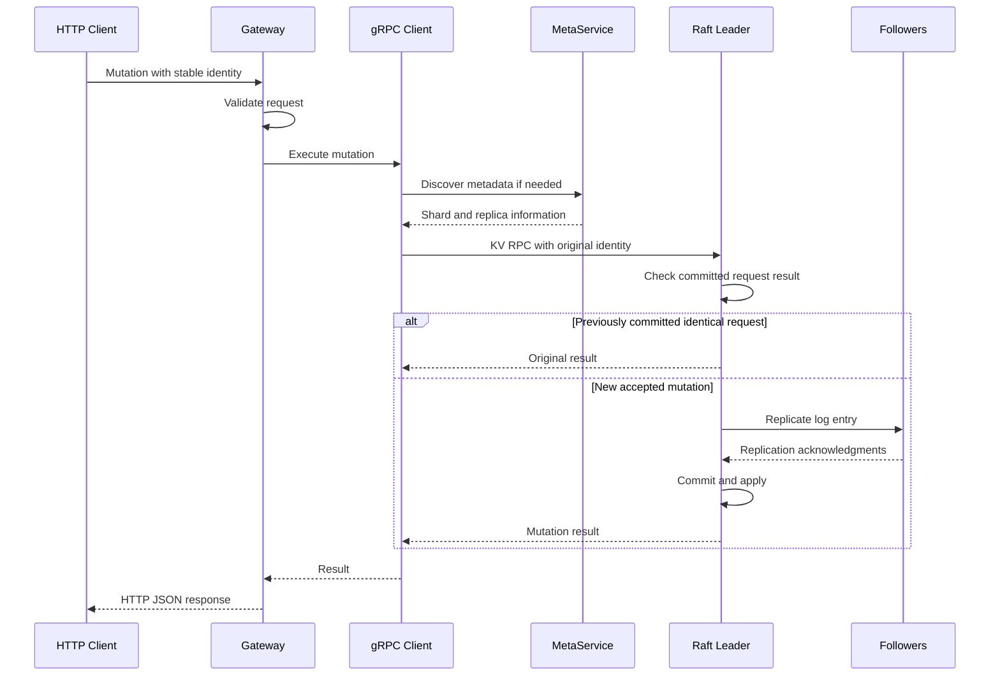

# HTTP-gRPC Gateway

## 1. Overview

Step 7.21 introduces a standalone HTTP-gRPC gateway for ShardRAFT.

The gateway exposes an HTTP key-value API backed by the existing
shard-aware gRPC client implemented in Step 7.20.

It provides:

- HTTP GET, PUT, DELETE, and compare-and-swap operations.
- Metadata discovery through MetaService.
- Leader-aware request routing.
- Default quorum-confirmed linearizable reads.
- Explicit local reads.
- Bounded retries and request deadlines.
- Stable mutation identities.
- Durable request deduplication through the backend.
- Structured HTTP error responses.
- Graceful process shutdown.

The gateway is an additional client-facing service. It does not
replace the existing daemon HTTP API or React dashboard.

## 2. Architecture



The gateway delegates routing, metadata discovery, retries,
connection management, and mutation identity handling to
the existing gRPC client.

The backend remains responsible for consensus, persistence,
request deduplication, and application of committed operations.

The gateway does not maintain an independent database.

## 3. Source Organization

| File | Responsibility |
|---|---|
| main.go | Command-line flags and signal handling |
| config.go | Gateway configuration and validation |
| client.go | Existing gRPC client integration |
| handler.go | HTTP routes and JSON responses |
| get.go | GET and read consistency modes |
| put.go | PUT mutation handler |
| delete.go | DELETE mutation handler |
| cas.go | Compare-and-swap handler |
| mutation.go | Strict JSON validation and mutation identities |
| mutation_errors.go | Mutation error translation |
| server.go | HTTP server lifecycle and graceful shutdown |

All gateway source files are located in:

```text
cmd/shardraft-gateway/
```

## 4. Configuration

| Flag | Default |
|---|---|
| -http-addr | 127.0.0.1:8085 |
| -grpc-endpoints | 127.0.0.1:9091,127.0.0.1:9092,127.0.0.1:9093 |
| -request-timeout | 11s |

The gateway validates addresses, ports, bootstrap endpoints,
and positive request timeouts.

Duplicate bootstrap endpoints are removed during flag parsing.

Wildcard and unspecified bootstrap endpoints are rejected.

### Internal client configuration

| Parameter | Value |
|---|---|
| Metadata cache TTL | 30 seconds |
| Metadata request timeout | 1 second |
| Maximum retry attempts | 5 |
| Per-attempt timeout | 2 seconds |
| Initial retry backoff | 25 milliseconds |
| Maximum retry backoff | 250 milliseconds |

The overall request context bounds backend operations.

## 5. Building and Starting

From the repository root:

```bash
mkdir -p bin

go build -o bin/shardraftd ./cmd/shardraftd
go build -o bin/shardraft-gateway ./cmd/shardraft-gateway
```

Start a compatible ShardRAFT cluster with KVService and
MetaService available on the configured gRPC endpoints.

Start the gateway:

```bash
./bin/shardraft-gateway \
  -http-addr 127.0.0.1:8085 \
  -grpc-endpoints 127.0.0.1:9091,127.0.0.1:9092,127.0.0.1:9093 \
  -request-timeout 11s
```

The existing development cluster must be configured with
gRPC listeners before it can serve as a gateway backend.

Display supported flags:

```bash
./bin/shardraft-gateway -help
```

The gateway can bootstrap through a follower because
metadata discovery and leader-aware routing are handled
by the gRPC client.

## 6. HTTP API

| Method | Path | Operation |
|---|---|---|
| GET | /kv/{key} | Read a value |
| PUT | /kv/{key} | Insert or update a value |
| DELETE | /kv/{key} | Delete a value |
| POST | /kv/{key}/cas | Compare-and-swap |

Keys and values are UTF-8 strings.

Keys must not be empty.

Empty string values are supported.

Application JSON responses use application/json and
Cache-Control: no-store.

### 6.1 PUT

```bash
curl -i -X PUT \
  http://127.0.0.1:8085/kv/gateway-demo \
  -H 'Content-Type: application/json' \
  -d '{
    "value": "100",
    "client_id": "gateway-demo-client",
    "request_id": "demo-put-001"
  }'
```

Example successful response:

```json
{
  "applied": true,
  "value": "100",
  "client_id": "gateway-demo-client",
  "request_id": "demo-put-001"
}
```

### 6.2 GET

```bash
curl -i \
  http://127.0.0.1:8085/kv/gateway-demo
```

Example successful response:

```json
{
  "key": "gateway-demo",
  "value": "100",
  "found": true
}
```

Explicit linearizable read:

```bash
curl -i \
  'http://127.0.0.1:8085/kv/gateway-demo?read_mode=linearizable'
```

Explicit local read:

```bash
curl -i \
  'http://127.0.0.1:8085/kv/gateway-demo?read_mode=local'
```

A missing key returns HTTP 404.

Unsupported read modes return HTTP 400.

### 6.3 Compare-and-Swap

```bash
curl -i -X POST \
  http://127.0.0.1:8085/kv/gateway-demo/cas \
  -H 'Content-Type: application/json' \
  -d '{
    "expected": "100",
    "value": "200",
    "client_id": "gateway-demo-client",
    "request_id": "demo-cas-001"
  }'
```

Example successful response:

```json
{
  "applied": true,
  "value": "200",
  "client_id": "gateway-demo-client",
  "request_id": "demo-cas-001"
}
```

A comparison mismatch returns HTTP 200 with applied=false.

A comparison mismatch is a normal operation result,
not an HTTP request conflict.

### 6.4 DELETE

```bash
curl -i -X DELETE \
  http://127.0.0.1:8085/kv/gateway-demo \
  -H 'Content-Type: application/json' \
  -d '{
    "client_id": "gateway-demo-client",
    "request_id": "demo-delete-001"
  }'
```

The operation returns the backend mutation result.

A subsequent GET returns HTTP 404 when the key is absent.

Use fresh request identities when repeating the demonstration
as a new workload. Reusing the same identities intentionally
replays the original mutation results.

## 7. Request Validation

Mutation requests require:

- A valid JSON object.
- Nonempty client_id and request_id strings.
- Valid UTF-8 request bytes.
- Operation-specific fields.
- A request body no larger than 1 MiB.

The decoder rejects:

- Malformed JSON.
- Duplicate fields.
- Unknown fields.
- Null fields.
- Non-string field values.
- Multiple JSON values in one request.
- Missing required fields.
- Fields that do not belong to the selected operation.

| Operation | Required fields |
|---|---|
| PUT | value, client_id, request_id |
| DELETE | client_id, request_id |
| CAS | expected, value, client_id, request_id |

The backend independently enforces its own protobuf
request-size and semantic validation requirements.

The gateway body limit does not guarantee that an equally
sized protobuf request will pass backend validation.

## 8. Read Consistency

### Linearizable reads

GET uses linearizable reads by default.

The backend uses its ReadIndex implementation to confirm
leadership through a quorum and enforce an applied-index
barrier before returning data.

The gateway does not implement an independent consensus
or read-consistency algorithm.

### Local reads

The local read mode permits reading from a replica without
requiring a fresh quorum confirmation.

Local reads can return stale values.

Applications requiring the latest linearizable state
should use the default read mode.

## 9. Mutation Identity and Durable Deduplication

Every mutation requires the identity pair:

```text
(client_id, request_id)
```

A logical mutation must retain the same identity across
all retries.

The gateway forwards the supplied identity to the gRPC
client, which preserves it across routing attempts.

The backend stores committed request results through its
persistent replicated state machine.

For the current single-shard deployment:

- Identical requests can replay the original result.
- Replaying a committed request does not require another
  mutation log entry.
- Reusing an identity with different mutation contents
  produces a request conflict.
- Different clients can independently use the same
  request_id.
- Previously committed results survive tested leader
  failover and process restart scenarios.

A historical replay returns its original operation result.
It does not overwrite a newer value.

Deduplication is implemented by the backend rather than
an in-memory gateway cache.

## 10. Committed Conflict Confirmation

Distributed testing identified a retry ambiguity when
a conflicting request was submitted during leader failover.

An earlier attempt could leave the client uncertain about
the mutation outcome, causing a subsequent conflict to
be reported as outcome_unknown.

The protocol now includes:

```protobuf
bool conflict_committed = 8;
```

This field belongs to RoutingError.

The backend sets it when an identity conflict is confirmed
against an existing committed and applied request result.

The client may resolve earlier ambiguity when it receives
a confirmed REQUEST_CONFLICT without a transport error.

An unconfirmed or pending conflict does not automatically
clear earlier ambiguity.

Older servers that omit the field retain the conservative
retry behavior.

The field is an additive protobuf change. Existing RPC
methods and field numbers are preserved.

The change is validated by dedicated backend, client,
and distributed gateway tests.

## 11. HTTP Error Translation

| HTTP status | Code | Meaning |
|---|---|---|
| 400 | invalid_request | Invalid input or request |
| 404 | key_not_found | Requested key is absent |
| 408 | request_canceled | Request was canceled |
| 409 | request_conflict | Mutation identity conflict |
| 503 | leader_unavailable | Routing or backend availability failure |
| 504 | deadline_exceeded | Request deadline exceeded |
| 504 | outcome_unknown | Mutation outcome could not be confirmed |
| 500 | internal_error | Unexpected operation failure |

Application errors use structured JSON.

Example:

```json
{
  "error": "Commit could not be confirmed. Retry using the original request identity.",
  "code": "outcome_unknown",
  "client_id": "gateway-demo-client",
  "request_id": "demo-put-001"
}
```

Backend mutation errors preserve the original request identity.

Validation errors occurring before identity extraction
may not contain identity fields.

The standard HTTP router may return its own responses
for unsupported paths or methods.

### Unknown mutation outcomes

HTTP 504 with outcome_unknown does not establish that
the mutation failed.

The operation might have committed before the response
was lost or the request deadline expired.

Retry the original operation using exactly the same
client_id, request_id, key, operation, and mutation values.

Do not generate a new identity merely because the previous
attempt returned an uncertain result.

## 12. Request Flow



The diagram illustrates successful new mutations and
committed identical replays.

Routing failures, request conflicts, deadlines, and
ambiguous outcomes follow the corresponding error paths.

## 13. Server Lifecycle

The gateway supports:

- Validated startup configuration.
- HTTP listener creation.
- Reusable gRPC client connections.
- SIGINT and SIGTERM handling.
- Graceful HTTP shutdown.
- Forced listener closure when graceful shutdown fails.
- Backend client connection cleanup.

| Server setting | Value |
|---|---|
| Read header timeout | 5 seconds |
| Read timeout | 10 seconds |
| Write timeout | Request timeout plus 15 seconds |
| Idle timeout | 60 seconds |
| Maximum header bytes | 1 MiB |
| Graceful shutdown timeout | 15 seconds |

The gateway process can restart independently of the
backend cluster.

Committed application data remains in the backend.

## 14. Distributed Integration Testing

The integration fixture launches:

- Three independent ShardRAFT daemon processes.
- One independent HTTP-gRPC gateway process.
- Real HTTP and gRPC listeners.
- Isolated temporary persistent storage directories.

The tests exercise actual networking and backend
replication rather than mocked gateway clients.

### Distributed test inventory

| Test | Scenario |
|---|---|
| TestGatewayDistributedBootstrapDiscovery | Bootstrap through a follower |
| TestGatewayDistributedCRUD | PUT, GET, and DELETE |
| TestGatewayDistributedReadModes | Default and explicit read modes |
| TestGatewayDistributedCAS | CAS success and mismatch |
| TestGatewayDistributedLeaderFailover | Leader replacement |
| TestGatewayDistributedDurableDeduplication | Replay across leader changes |
| TestGatewayDistributedRequestConflicts | Conflicting mutation identities |
| TestGatewayDistributedClientIdentityIsolation | Independent client identities |
| TestGatewayDistributedConflictAfterFailover | Confirmed cross-leader conflict |
| TestGatewayDistributedQuorumLossAndRecovery | Majority loss and restoration |
| TestGatewayDistributedConcurrentPut | Concurrent distinct writes |
| TestGatewayDistributedConcurrentIdenticalMutations | Concurrent duplicate requests |
| TestGatewayDistributedConcurrentConflictingIdentities | Concurrent identity conflicts |
| TestGatewayDistributedConcurrentCASContention | CAS contention |
| TestGatewayDistributedConcurrentDelete | Concurrent deletes |
| TestGatewayDistributedConcurrentReplicaConvergence | Mixed workload and replica convergence |
| TestGatewayDistributedBackendUnavailable | Complete backend outage and recovery |
| TestGatewayDistributedGatewayRestart | Independent gateway restart |
| TestGatewayDistributedDeduplicationAfterGatewayRestart | Durable replay after gateway restart |

The concurrent tests verify operation results, request
identity preservation, expected commit-index progression,
and the absence of additional mutation commits on replay.

The replica convergence test also verifies key-value
state through direct local reads from each replica.

## 15. Running Tests

### Gateway unit tests

```bash
SHARDRAFT_GATEWAY_INTEGRATION=0 \
  go test -count=1 ./cmd/shardraft-gateway
```

### Gateway unit coverage

```bash
SHARDRAFT_GATEWAY_INTEGRATION=0 \
  go test -cover -count=1 ./cmd/shardraft-gateway
```

### Distributed integration tests

```bash
(
  set -e

  BIN_DIR="$(mktemp -d)"
  trap 'rm -rf "$BIN_DIR"' EXIT

  go build -o "$BIN_DIR/shardraftd" ./cmd/shardraftd
  go build -o "$BIN_DIR/shardraft-gateway" ./cmd/shardraft-gateway

  export SHARDRAFT_GATEWAY_INTEGRATION=1
  export SHARDRAFT_DAEMON_BINARY="$BIN_DIR/shardraftd"
  export SHARDRAFT_GATEWAY_BINARY="$BIN_DIR/shardraft-gateway"

  go test -v -count=1 -timeout=300s \
    -run '^TestGatewayDistributed' \
    ./cmd/shardraft-gateway
)
```

### Shuffled distributed stress tests

```bash
(
  set -e

  BIN_DIR="$(mktemp -d)"
  trap 'rm -rf "$BIN_DIR"' EXIT

  go build -o "$BIN_DIR/shardraftd" ./cmd/shardraftd
  go build -o "$BIN_DIR/shardraft-gateway" ./cmd/shardraft-gateway

  export SHARDRAFT_GATEWAY_INTEGRATION=1
  export SHARDRAFT_DAEMON_BINARY="$BIN_DIR/shardraftd"
  export SHARDRAFT_GATEWAY_BINARY="$BIN_DIR/shardraft-gateway"

  go test -v -shuffle=on -count=5 -timeout=1200s \
    -run '^TestGatewayDistributed' \
    ./cmd/shardraft-gateway
)
```

### Race-instrumented distributed tests

Both subprocess binaries must be race-instrumented
in addition to the Go integration test process.

```bash
(
  set -e

  BIN_DIR="$(mktemp -d)"
  trap 'rm -rf "$BIN_DIR"' EXIT

  go build -race -o "$BIN_DIR/shardraftd" ./cmd/shardraftd
  go build -race -o "$BIN_DIR/shardraft-gateway" ./cmd/shardraft-gateway

  export SHARDRAFT_GATEWAY_INTEGRATION=1
  export SHARDRAFT_DAEMON_BINARY="$BIN_DIR/shardraftd"
  export SHARDRAFT_GATEWAY_BINARY="$BIN_DIR/shardraft-gateway"

  go test -race -v -shuffle=on -count=3 -timeout=1200s \
    -run '^TestGatewayDistributed' \
    ./cmd/shardraft-gateway
)
```

### Complete backend validation

```bash
SHARDRAFT_GATEWAY_INTEGRATION=0 go test -count=1 ./...
SHARDRAFT_GATEWAY_INTEGRATION=0 go test -race -count=1 ./...

go build ./...
go vet ./...
go mod verify

test -z "$(gofmt -l cmd internal proto)"

git diff --check
```

## 16. Verified Results

The final Step 7.21.11 regression recorded:

| Validation | Result |
|---|---|
| Gateway test functions | 78 |
| Gateway unit test functions | 59 |
| Distributed test functions | 19 |
| Distributed baseline executions | 19/19 passed |
| Shuffled distributed stress executions | 95/95 passed |
| Distributed race executions | 57/57 passed |
| Complete gateway suite | 78/78 passed |
| Total distributed executions across these suites | 190/190 passed |
| Gateway unit statement coverage | 95.5% |
| gRPC client statement coverage | 92.5% |
| Backend package regression | 16/16 passed |
| Backend package race regression | 16/16 passed |
| Build | Passed |
| Static analysis | Passed |
| Module verification | Passed |
| Dependency validation | Passed |
| Formatting validation | Passed |
| Whitespace validation | Passed |

No race warnings were reported in the recorded final
regression.

Gateway GET, PUT, DELETE, and CAS handlers achieved
100% statement coverage in the recorded unit tests.

These results apply to the tested implementation and
scenarios. They are not a proof of correctness under
all possible distributed-system executions.

## 17. Compatibility

The gateway preserves:

- Existing daemon HTTP endpoints.
- Existing React dashboard architecture.
- Existing Raft and Admin gRPC services.
- Existing KV and metadata RPC methods.
- Existing Go module dependencies.
- Existing persistent storage architecture.

The committed-conflict confirmation field is an additive
protocol extension.

The gateway does not require frontend changes.

Browser E2E tests were not part of the final gateway
regression described in this document.

## 18. Current Limitations

- The production deployment contains one Raft group
  owning all 65,536 logical hash slots.
- Physical multi-shard deployment and dynamic shard
  migration remain future work.
- Live WRONG_SHARD transitions across physical groups
  are not established by these gateway integration tests.
- The gateway uses plaintext HTTP and insecure gRPC
  transport for local development.
- Authentication, authorization, TLS, rate limiting,
  and production deployment hardening remain future work.
- The gateway does not provide dedicated health,
  readiness, or metrics endpoints.
- Local reads may return stale data.
- Backend recovery can require time for election,
  connection recovery, and majority readiness.
- Restart tests cover controlled process shutdown and
  restart rather than every abrupt crash or storage fault.
- Request deduplication across future shard migrations
  requires additional ownership and state-transfer guarantees.
- Exhaustive linearizability verification and production
  performance benchmarks remain future work.

## 19. Related Documentation

- [gRPC KV Service](GRPC_KV_SERVICE.md)
- [gRPC Metadata Service](GRPC_METADATA_SERVICE.md)
- [Shard-Aware gRPC Client](GRPC_CLIENT.md)
- [ReadIndex and Linearizable Reads](READ_INDEX.md)
- [Request Routing](REQUEST_ROUTING.md)
- [Sharding and Metadata Group](SHARDING.md)
- [Integration Validation](INTEGRATION_VALIDATION.md)
- [Development Checklist](CHECKLIST.md)
