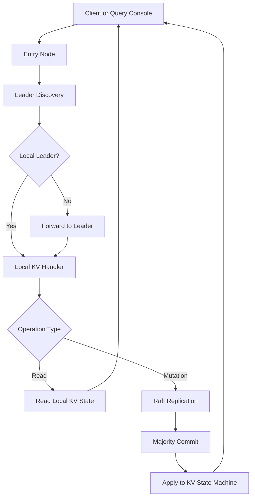

# Request Routing and Leader Redirection

## Overview

ShardRAFT supports automatic request routing within a single
three-node Raft group. Clients can submit KV requests to any
reachable node without manually locating the current leader.

## Supported Operations

| Operation | Endpoint |
|---|---|
| GET | GET /kv/{key} |
| PUT | PUT /kv/{key} |
| DELETE | DELETE /kv/{key} |
| Compare-and-swap | POST /kv/{key}/cas |

Mutations require a client_id and request_id.

## Architecture

## Leader Discovery

- Queries configured peers for their current Raft status.
- Evaluates observed terms and leader identities.
- Rejects conflicting leader information.
- Prevents multi-hop request forwarding.
- Rechecks leadership when retrying eligible requests.

## Retry and Deduplication

- Backend routing allows up to three attempts.
- Frontend routing allows up to three entry-node attempts.
- Retries preserve the original mutation payload and identity.
- Applied mutation results are retained by the KV state machine.
- Repeated applied mutation identities return recorded results.
- Conflicting payloads using the same identity are rejected.

## Routing Errors

| HTTP Status | Code | Meaning |
|---|---|---|
| 503 | not_leader | Leadership changed |
| 503 | leader_unavailable | Leader could not be established |
| 504 | outcome_unknown | Mutation commitment could not be confirmed |

An unknown outcome does not mean the mutation failed.
The operation may commit after quorum is restored.

Clients should retry an unresolved mutation using the same
client_id, request_id, and payload.

## Frontend Integration

The Query Console supports automatic entry-node selection,
fallback between nodes, bounded retries, and explicit retry
of unresolved mutations.

## Implementation Files

### Backend

- cmd/shardraftd/leader_discovery.go
- cmd/shardraftd/request_router.go
- cmd/shardraftd/request_retry.go
- cmd/shardraftd/routing_errors.go
- cmd/shardraftd/kv_http.go
- cmd/shardraftd/kv_mutations.go

### Frontend

- web/src/api/routing.ts
- web/src/features/QueryConsole.tsx
- web/src/App.tsx

## Verified Scenarios

- Requests submitted through followers.
- Automatic leader discovery.
- PUT, GET, DELETE, and CAS operations.
- Duplicate mutation replay.
- Leader failure and replacement.
- Writes through a surviving follower.
- Quorum loss without false success acknowledgment.
- Recovery of pending mutations after quorum restoration.
- Persistent storage recovery after restart.

## Limitations

- Routing currently operates within one Raft group.
- Peer status checks do not establish linearizable reads.
- Network-based snapshot installation remains future work.
- Pending frontend requests are not guaranteed to survive
  page reloads or navigation.
- Tests cover selected failure scenarios, not every possible
  distributed-system execution.

## Related Documentation

See [Integration Validation](INTEGRATION_VALIDATION.md)
for regression tests, failover results, and benchmark measurements.
